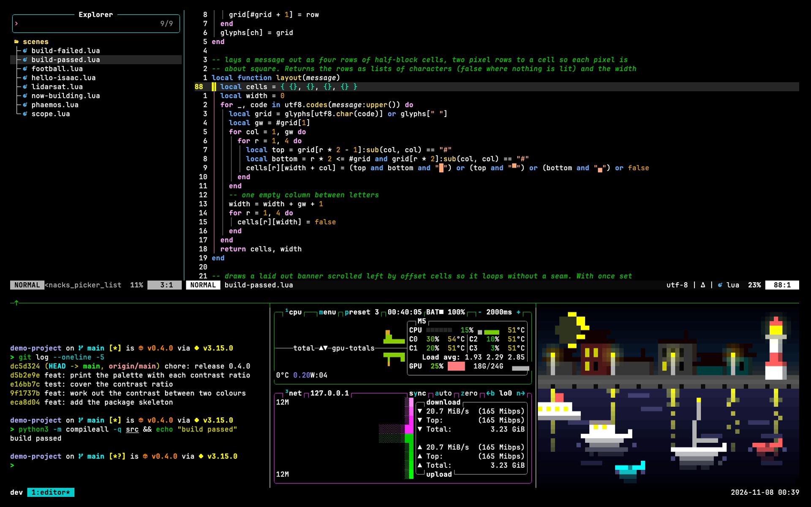
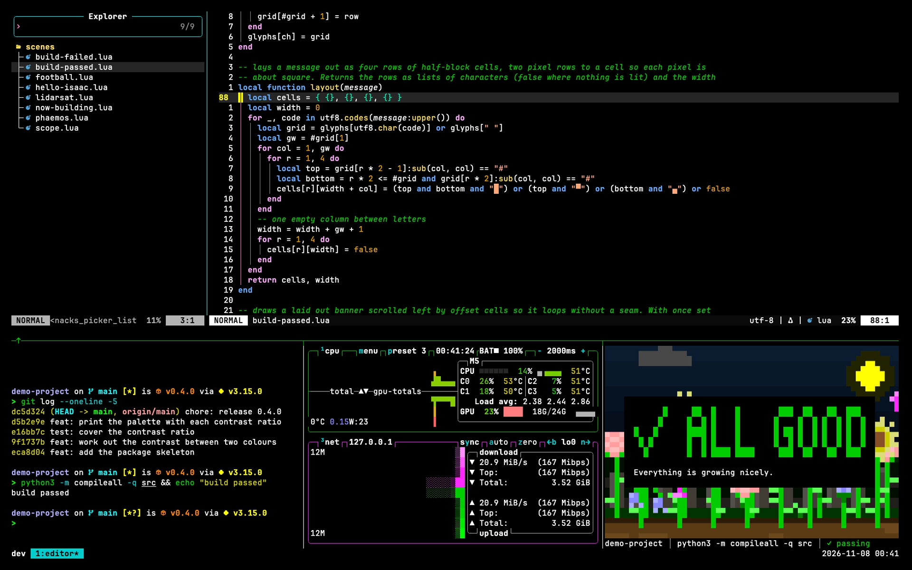
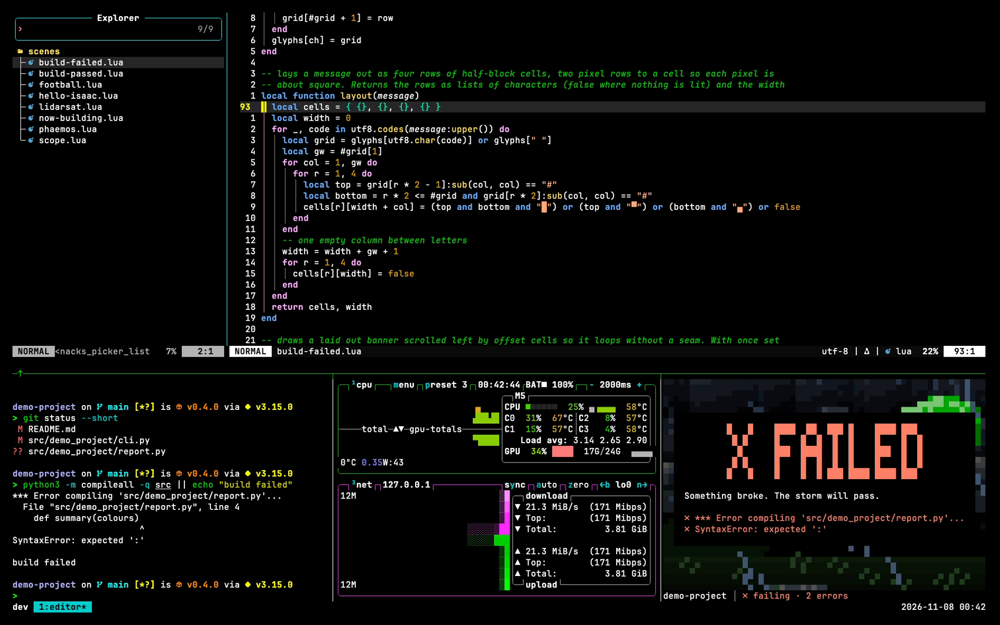

# dotfiles

> My whole developer setup in one place: one-command bootstraps for macOS, Windows and Linux, shell
> profiles, terminals, editors and IDEs, Git and SSH, all in matching high-contrast themes.

[](https://github.com/zaccesss/dotfiles/actions/workflows/ci.yml)
[](LICENSE)

<a href="terminal/tmux/docs/demo/hero-dark.gif"><picture><source media="(prefers-color-scheme: light)" srcset="terminal/tmux/docs/demo/hero-light.png"><source media="(prefers-color-scheme: dark)" srcset="terminal/tmux/docs/demo/hero-dark.png"></picture></a>

<table>
<tr>
<td width="50%"><a href="terminal/tmux/docs/demo/hero-pass-dark.gif"><picture><source media="(prefers-color-scheme: light)" srcset="terminal/tmux/docs/demo/hero-pass-light.png"><source media="(prefers-color-scheme: dark)" srcset="terminal/tmux/docs/demo/hero-pass-dark.png"></picture></a><br>A passing build</td>
<td width="50%"><a href="terminal/tmux/docs/demo/hero-fail-dark.gif"><picture><source media="(prefers-color-scheme: light)" srcset="terminal/tmux/docs/demo/hero-fail-light.png"><source media="(prefers-color-scheme: dark)" srcset="terminal/tmux/docs/demo/hero-fail-dark.png"></picture></a><br>A failing build</td>
</tr>
</table>

---

## What this is

I work across a MacBook Air, a Lenovo laptop running Windows and Linux and a Windows desktop PC. This
repository holds everything that makes those machines feel the same: the bootstraps that set a
machine up, the shell profile and its aliases, the terminal and its tools, Git and SSH, every editor
and IDE and the few desktop apps I drive from the keyboard.

I have monocular vision, so distinct, high-contrast colours do real work for me rather than being a
matter of taste. Every folder uses the same Zacess themes, with Zacess Deep Contrast Dark as
the default, so moving between a terminal, an editor and an IDE never changes how the screen reads.
The [accessibility statement](ACCESSIBILITY.md) says what that means in practice.

Each tool lives in its own folder with its own README, guides and screenshots. Nothing depends on
cloning more than this one repository.

## Install

> [!WARNING]
> These are personal configs for my own machines. Read the bootstrap README for your platform
> before running it. Read the [shell NOTICE](shell/NOTICE.md) before sourcing the profile on a
> machine of your own.

macOS:

```bash
xcode-select --install
git clone https://github.com/zaccesss/dotfiles.git ~/dev/github/repos/dotfiles
~/dev/github/repos/dotfiles/setup/mac-bootstrap/bootstrap/bootstrap.sh
```

Ubuntu, including WSL2 and virtual machines:

```bash
sudo apt update && sudo apt install -y git
git clone https://github.com/zaccesss/dotfiles.git ~/dev/github/repos/dotfiles
~/dev/github/repos/dotfiles/setup/linux-bootstrap/bootstrap/bootstrap.sh --with configs
```

Windows 11, in Windows Terminal as your normal user:

```powershell
winget install --id Git.Git --exact
git clone https://github.com/zaccesss/dotfiles.git "$HOME\dev\github\repos\dotfiles"
& "$HOME\dev\github\repos\dotfiles\setup\windows-bootstrap\bootstrap\bootstrap.ps1" -Plan   # see what would happen
& "$HOME\dev\github\repos\dotfiles\setup\windows-bootstrap\bootstrap\bootstrap.ps1"         # do it
```

To use one tool on its own, open its folder below and follow its setup guide.

## What is inside

| Group | What it holds |
| --- | --- |
| [setup](setup/README.md) | The macOS, Linux and Windows bootstraps and the captured desktop settings they apply |
| [shell](shell/README.md) | The zsh, bash and PowerShell profiles with their aliases and helpers, the Starship prompt, the Command Prompt start-up and the `zt` theme switcher |
| [terminal](terminal/README.md) | The Zacess terminal themes, tmux and the everyday command line tools |
| [git](git/README.md) | The gitconfig, the Git hooks and the SSH client config |
| [editors](editors/README.md) | VS Code, Zed, the JetBrains IDEs, Eclipse, STM32CubeIDE, Xcode, Neovim, Arduino IDE, Microchip Studio, KiCad, Vivado, Processing, Notepad++, Nextpad++, nano, Thonny, MATLAB, LTspice and Proteus |
| [apps](apps/README.md) | Raycast and Rectangle on the Mac, Obsidian, Zotero, Zacess Scenes with eight custom Lua scenes and Zacess Games everywhere, OneDrive on Linux and TranslucentTB on Windows |

How the repository is checked and maintained (every workflow, issue form and template) is in
[.github/ABOUT.md](.github/ABOUT.md).

## Contributing and support

See [CONTRIBUTING.md](CONTRIBUTING.md) before opening a pull request, [SUPPORT.md](SUPPORT.md) for
where to ask a question and [SECURITY.md](SECURITY.md) for reporting a security issue privately.
Everyone taking part follows the [code of conduct](CODE_OF_CONDUCT.md).

## Licence

MIT, apart from the three bootstraps in [setup/](setup/README.md), which are Apache 2.0. See
[LICENSE](LICENSE), each bootstrap's own `LICENSE` and [NOTICE.md](NOTICE.md).
