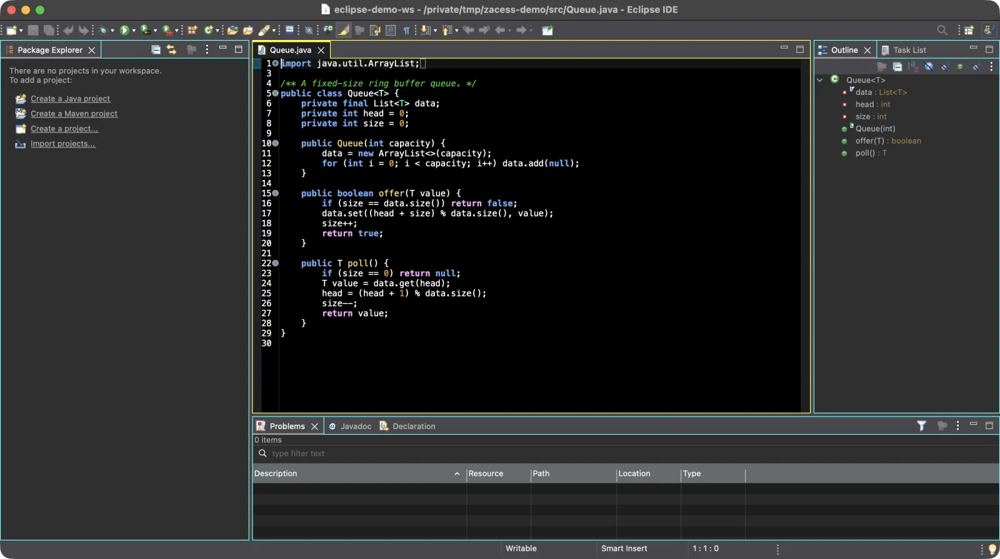
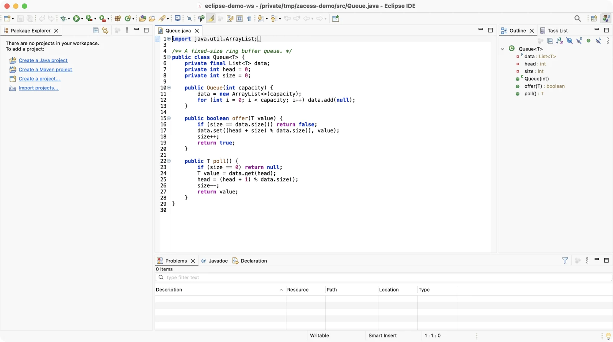
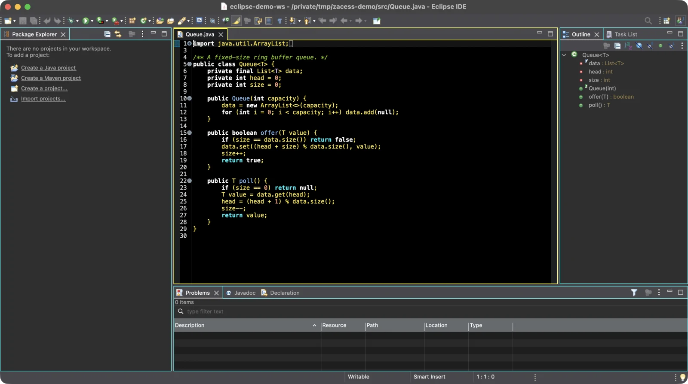
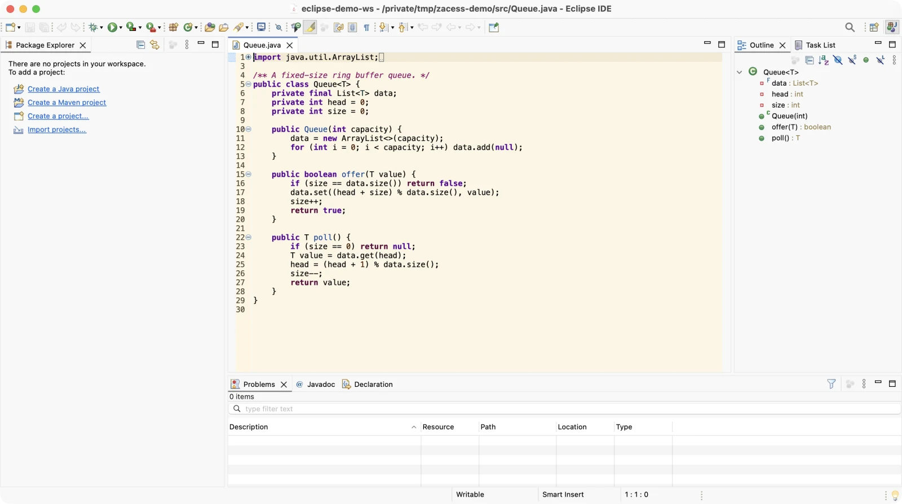
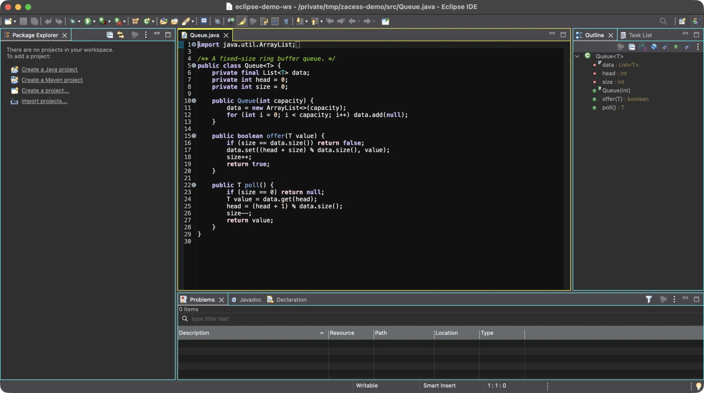
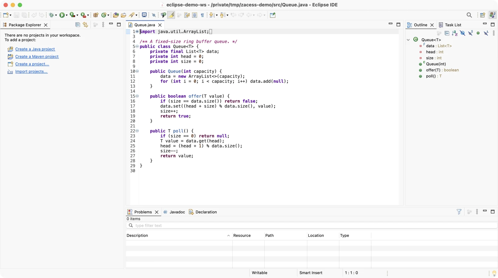
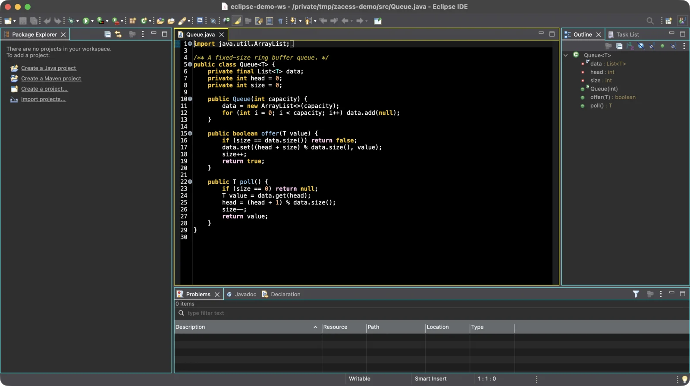
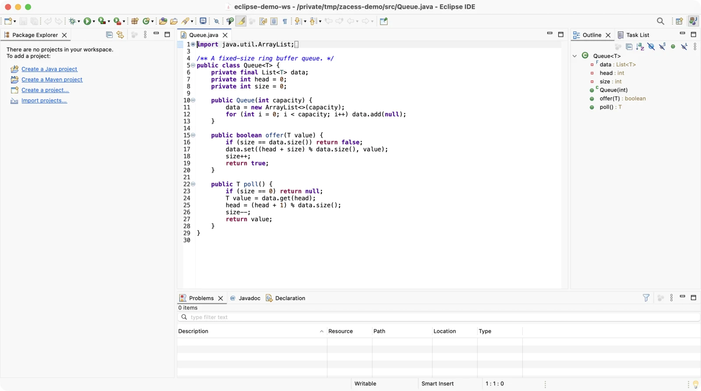

# eclipse

> Eclipse IDE preferences: Java 25 compiler defaults, autosave, editor basics and 15 VS Code style
> key bindings, with merge scripts for macOS, Linux and Windows that apply them to a workspace.

Eclipse has no single settings file. It keeps preferences in `.prefs` files inside each workspace's
`.metadata` folder, mixed in with values it writes for itself. Copying those files over would wipe
all of that, so this folder holds only the chosen keys and merges them in.

## What's here

- [`prefs/`](prefs/) - the preferences, one fragment per Eclipse `.prefs` file: Java 25 compiler
  compliance, autosave every 20 seconds, line numbers, spaces for tabs at width 4, current line
  highlight, spell checking in British English and 15 key bindings. Identical on every platform.
- [`apply.sh`](apply.sh) (macOS and Linux) and [`apply.ps1`](apply.ps1) (Windows) - merge the
  fragments and the chosen theme in key by key and print what changed, with no backup. The Windows script also lists PowerShell 7 in the Terminal view. Both refuse to run
  while Eclipse is open.
- [`theme/`](theme/) - the eight Zacess Eclipse themes from
  [Zacess Themes](https://github.com/zacesshq/themes) 0.6.0 (editor and Terminal view colours), tab
  outlines for the two Deep Contrast themes and an outline stylesheet for the Dark theme on macOS.
  The scripts import Zacess Deep Contrast Dark by default. `--theme <name>` (`-Theme` on Windows)
  picks another and `--no-theme` (`-NoTheme`) skips it.
- [`plugins.txt`](plugins.txt) - suggested plugins with their update sites.

## In action

Eclipse IDE in each of the eight Zacess themes, with the same file open.

| Deep Contrast Dark | Deep Contrast Light |
| --- | --- |
|  |  |

| Yellow on Black | Cream |
| --- | --- |
|  |  |

| Dark | Light |
| --- | --- |
|  |  |

| High Contrast Dark | High Contrast Light |
| --- | --- |
|  |  |

The themes are from [Zacess Themes](https://github.com/zacesshq/themes).

## Setup

Full walkthrough, including the JDK, in [guides/setup.md](guides/setup.md). In short, quit Eclipse
and run:

```bash
git clone https://github.com/zaccesss/dotfiles.git ~/dev/github/repos/dotfiles
~/dev/github/repos/dotfiles/editors/eclipse/apply.sh
```

> [!IMPORTANT]
> Quit Eclipse first. Eclipse keeps preferences in memory and writes them back when it exits, so a
> merge made while it runs would be lost. The scripts check and refuse.

## Structure

| Path | Contents |
| --- | --- |
| [`ACCESSIBILITY.md`](ACCESSIBILITY.md) | Font size, autosave, spell checking and the key bindings |
| [`prefs/`](prefs/) | Merged into `<workspace>/.metadata/.plugins/org.eclipse.core.runtime/.settings/` |
| [`guides/`](guides/) | Setup walkthrough and the preferences and key binding reference |
| [`docs/demo/`](docs/demo/) | Screenshots of the editor in the Zacess themes |
