# jetbrains

> JetBrains IDE setup: plugin lists per IDE, a small custom keymap layered on the VS Code keymap
> and Toolbox settings for macOS, Linux and Windows.

JetBrains configuration is split by IDE (IntelliJ IDEA, PyCharm, WebStorm, CLion, DataSpell) as
well as by platform. This folder keeps the parts worth sharing in one place so every IDE points at
the same setup instead of drifting on its own defaults.

## What's here

- **`plugins/<ide>.txt`** - every non-bundled plugin installed in that IDE, one `plugin.id@version`
  per line, grouped under `//` category headers. Ids and versions come from each plugin's own
  `plugin.xml`, not the folder name JetBrains uses on disk. A plugin id and version are the same on
  every OS, so there is one list per IDE rather than one per platform. Every plugin is described in
  [guides/plugins.md](guides/plugins.md).
- **`keymaps/`** - a small custom keymap layered on top of the `VSCode OSX` and `VSCode` keymaps,
  one file for macOS and one for Windows and Linux. See [guides/reference.md](guides/reference.md#keymaps).
- **`options/`** - `laf.xml` and `colors.scheme.xml`, which set the Zacess Deep Contrast Dark theme
  and editor scheme from the Zacess Themes plugin, fixed whatever the system appearance. See
  [guides/setup.md](guides/setup.md#5-use-the-zacess-deep-contrast-theme). `editor-font.xml`
  and `terminal-font.xml` set GeistMono Nerd Font and its Mono build, which must be installed first;
  `options/windows/` has the same files with the Windows font names. See
  [guides/setup.md](guides/setup.md#6-set-the-fonts).
- **`colors/`** - High Contrast Dark and High Contrast Light, the earlier colour schemes that set
  only the console and terminal colours on top of a bundled scheme.
- **`file-templates/`** - a `Class.java` template with a `main` method.
- **`toolbox/<platform>/settings.json`** - JetBrains Toolbox's user-configurable settings.
  `shell_scripts.location` is the one value that differs per platform.

## In action

IntelliJ IDEA and PyCharm in each of the eight Zacess themes, each IDE with one file open throughout.

### IntelliJ IDEA

| Deep Contrast Dark | Deep Contrast Light |
| --- | --- |
| 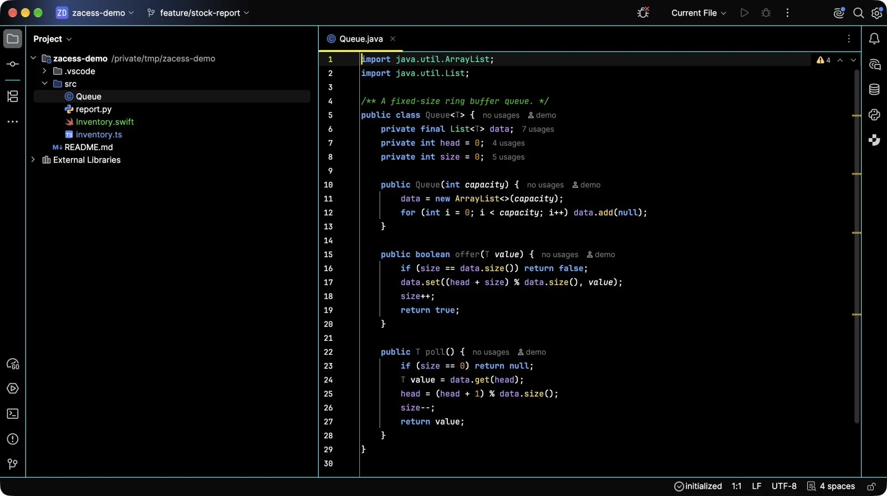 | 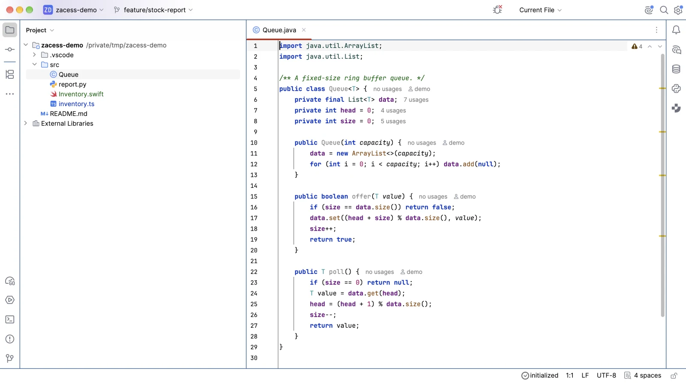 |

| Yellow on Black | Cream |
| --- | --- |
| 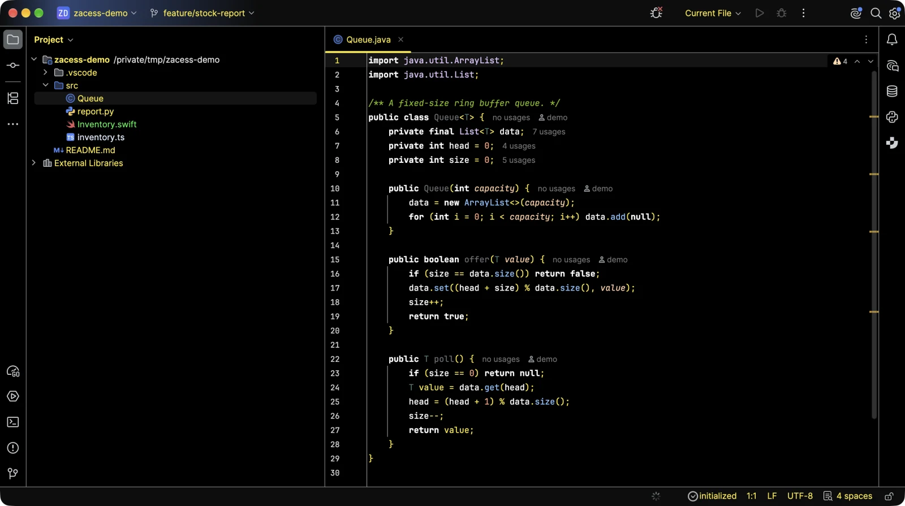 | 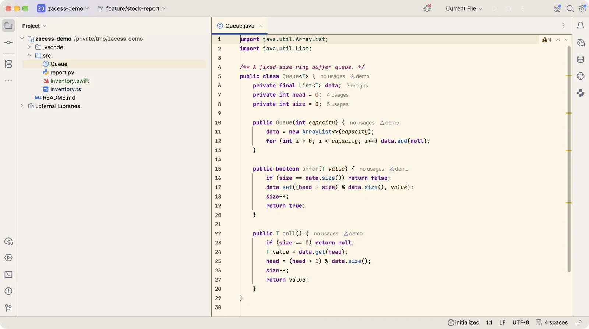 |

| Dark | Light |
| --- | --- |
| 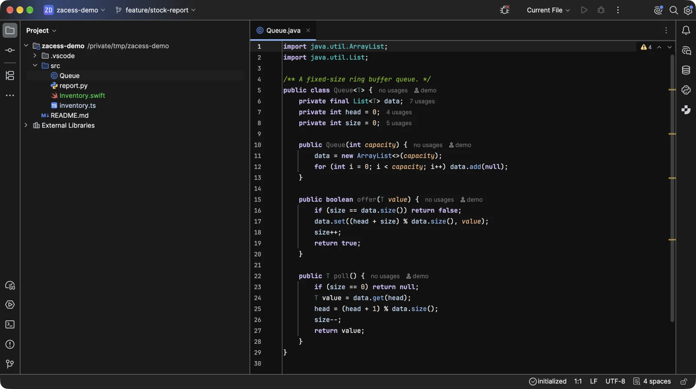 | 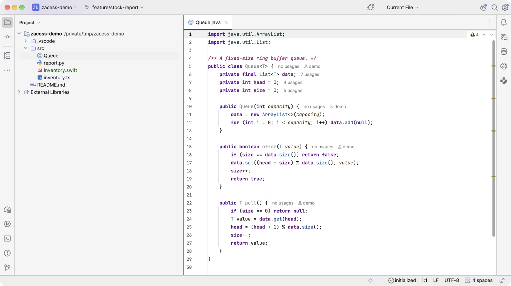 |

| High Contrast Dark | High Contrast Light |
| --- | --- |
| 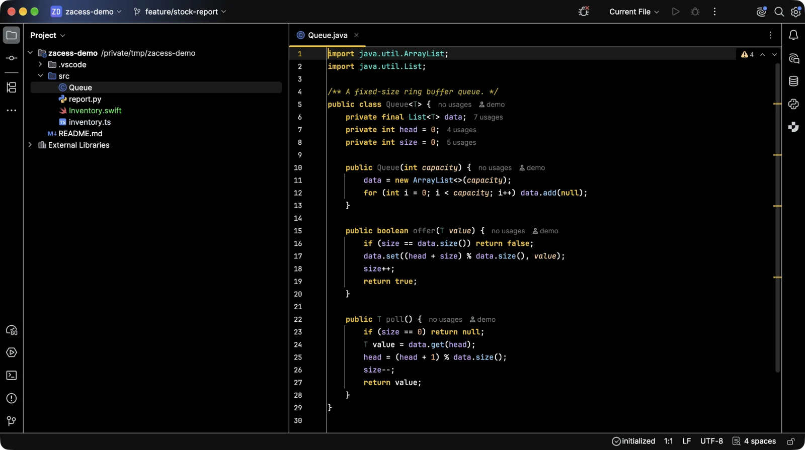 | 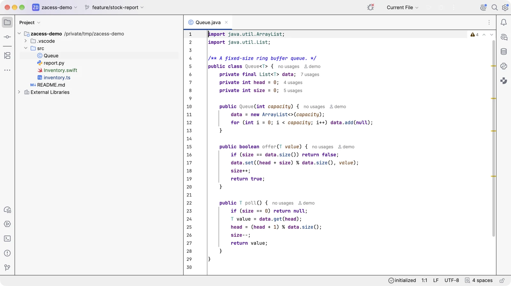 |

### PyCharm

| Deep Contrast Dark | Deep Contrast Light |
| --- | --- |
| 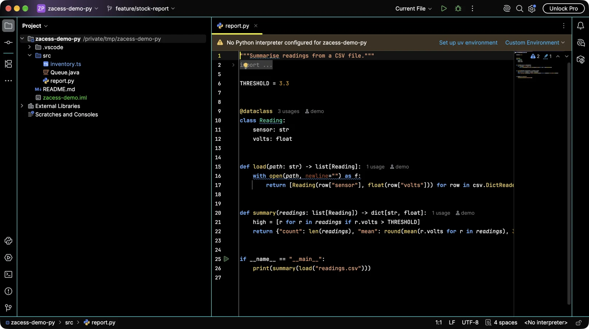 | 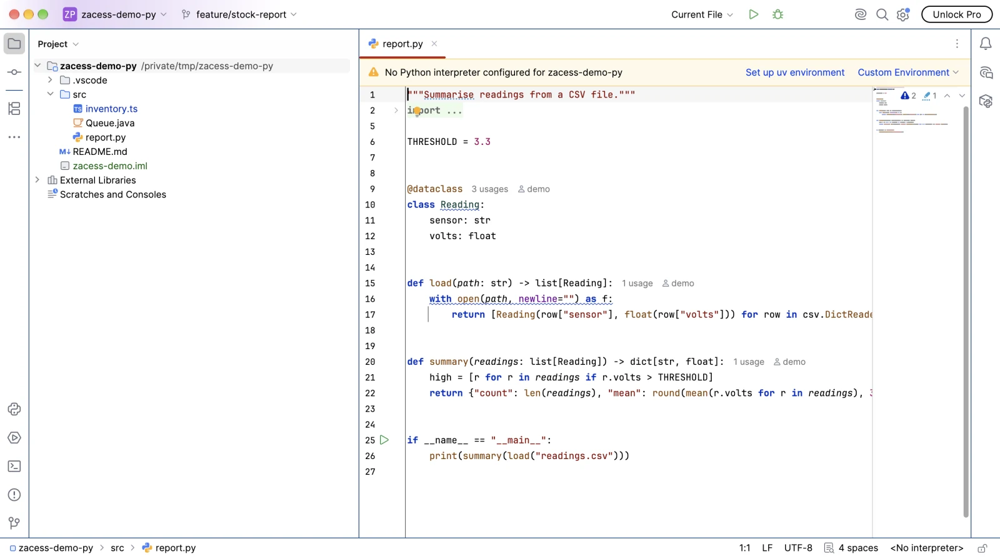 |

| Yellow on Black | Cream |
| --- | --- |
| 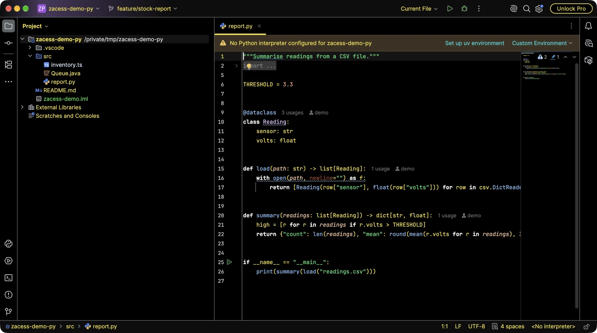 | 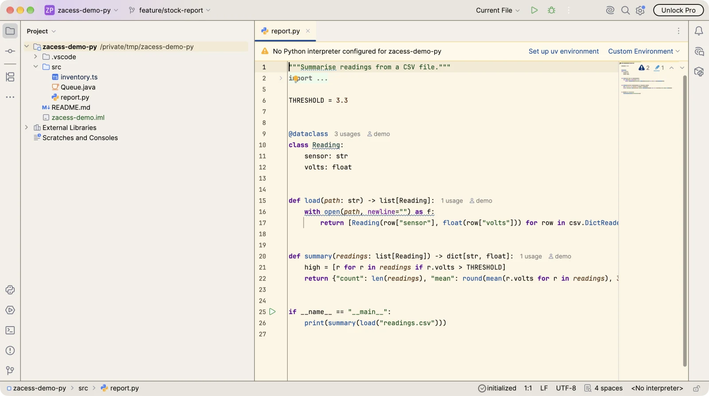 |

| Dark | Light |
| --- | --- |
| 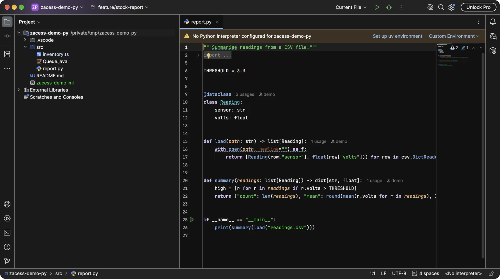 | 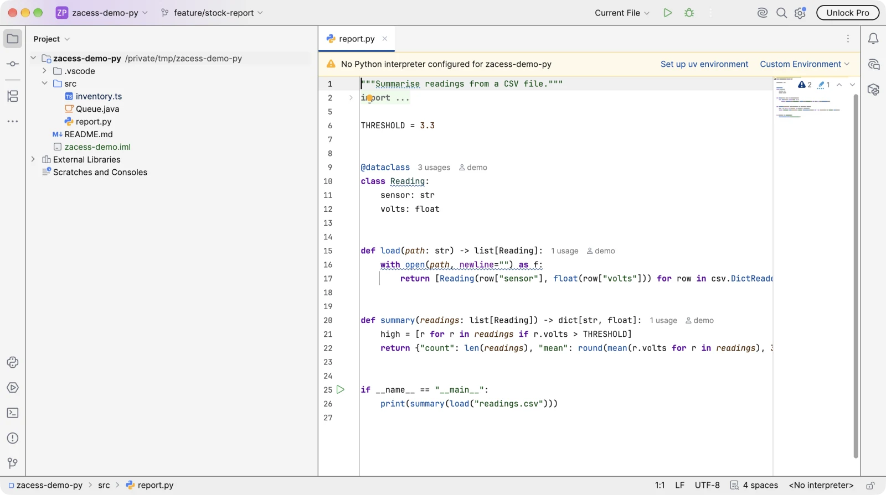 |

| High Contrast Dark | High Contrast Light |
| --- | --- |
| 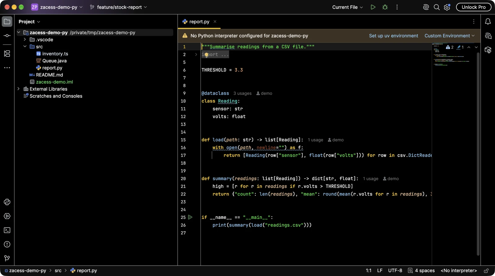 | 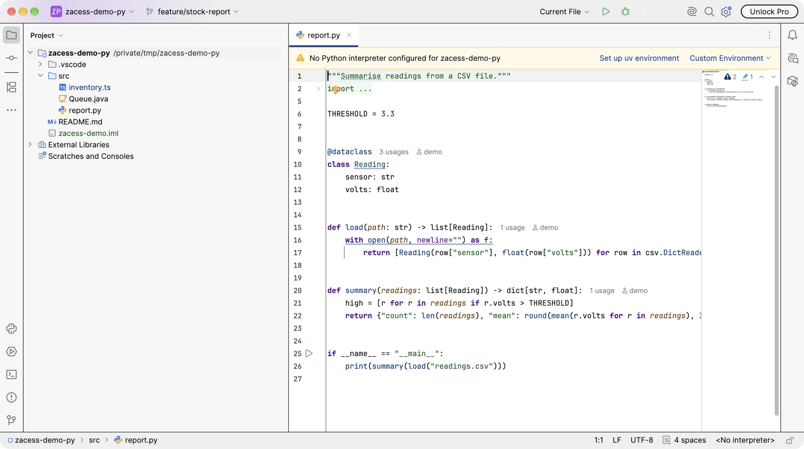 |

The themes are from [Zacess Themes](https://github.com/zacesshq/themes).

## Setup

Full walkthrough in [guides/setup.md](guides/setup.md).

> [!IMPORTANT]
> The custom keymaps use `VSCode OSX` or `VSCode` as their parent. Those keymaps come from the
> `com.intellij.plugins.vscodekeymap` plugin, so install it first or the custom keymap will not
> load.

## Apply

Quit every JetBrains IDE first. The IDEs hold their settings in memory and write them back on exit, so the scripts refuse to run while one is open. An IDE has to have been started once, so its config folder exists.

```bash
mac/apply.sh                 # or linux/apply.sh
mac/apply.sh --theme cream   # another Zacess theme
```

```powershell
pwsh -File windows\apply.ps1
pwsh -File windows\apply.ps1 -Theme cream
```

For every IDE config folder (`~/Library/Application Support/JetBrains/<IDE><version>` on macOS, `~/.config/JetBrains/<IDE><version>` on Linux, `%APPDATA%\JetBrains\<IDE><version>` on Windows) the scripts:

1. install the Zacess Themes plugin when it is missing, with the IDE's own `installPlugins` command (`com.zacess.themes`, from the [JetBrains Marketplace](https://plugins.jetbrains.com/plugin/35082-zacess-themes)). The launcher is found through the IDE's `product-info.json`, under `/Applications` and `~/Applications` on macOS, the Toolbox `apps` folder, `~/dev/tools/jetbrains` and `/opt` on Linux and `%LOCALAPPDATA%\Programs` on Windows. With no launcher found, the release zip pinned in [`shared/theme-package.json`](shared/theme-package.json) is checked against its SHA-256 digest and unpacked into the IDE's `plugins` folder instead
2. copy in the colour schemes in `colors/`, the file template in `file-templates/` and the custom keymap in `keymaps/` for that platform, plus `editor-font.xml` and `terminal-font.xml` from `options/` (`options/windows` on Windows, which lists Geist Mono under its short names)
3. make the custom keymap active in `options/<os>/keymap.xml`, once the VSCode keymap plugin it is built on is installed, since without that parent the keymap would not load
4. write `laf.xml` and `colors.scheme.xml` for the theme (`--theme`, `-Theme` on Windows), through the same function `zt` uses in `shell/scripts/zt.py`, so `zt` and the scripts write identical files
5. point new projects at `~/dev/projects` in `options/ide.general.xml`, the projects folder every editor shares, as JetBrains' own `$USER_HOME$` macro so the file reads the same on every machine. Existing projects stay where they are

Each file is printed as `added`, `changed`, `unchanged` or `skipped`. Running a script again changes nothing. Nothing is backed up: this folder holds every value the scripts write. `mac/apply.sh` and `linux/apply.sh` are the same file; the work is done by [`shared/apply.py`](shared/apply.py) with the system `python3`. The bootstraps run the scripts in their apps stage. Toolbox's own settings in `toolbox/` stay a by-hand step, since the Toolbox app runs all the time.

## Validation

[`scripts/validate.py`](scripts/validate.py) runs in CI on Linux. It checks the theme package pins a release with a full digest, that every list in `plugins/` names the theme plugin, that `options/` names a Zacess theme and Geist Mono, that each keymap's parent is the VSCode keymap, that `shared/apply.py` parses and that the two shell scripts match.

## Structure

| Path | Contents |
| --- | --- |
| [`ACCESSIBILITY.md`](ACCESSIBILITY.md) | The Zacess Deep Contrast theme plus the shared VS Code keymap that keeps one set of shortcuts across editors |
| [`plugins/`](plugins/) | One plugin list per IDE |
| [`keymaps/`](keymaps/) | Custom keymaps for macOS and for Windows and Linux |
| [`colors/`](colors/) | Console and terminal colours for dark and light mode |
| [`file-templates/`](file-templates/) | The `Class.java` file template |
| [`toolbox/`](toolbox/) | JetBrains Toolbox settings, per platform |
| [`shared/`](shared/) | The pinned theme plugin release and the apply script's Python |
| [`mac/apply.sh`](mac/apply.sh), [`linux/apply.sh`](linux/apply.sh) and [`windows/apply.ps1`](windows/apply.ps1) | The apply scripts, one per platform |
| [`scripts/`](scripts/) | The validator CI runs |
| [`guides/`](guides/) | Setup walkthrough, settings reference and per-plugin detail |
| [`docs/demo/`](docs/demo/) | Screenshots of the editor in the Zacess themes |
