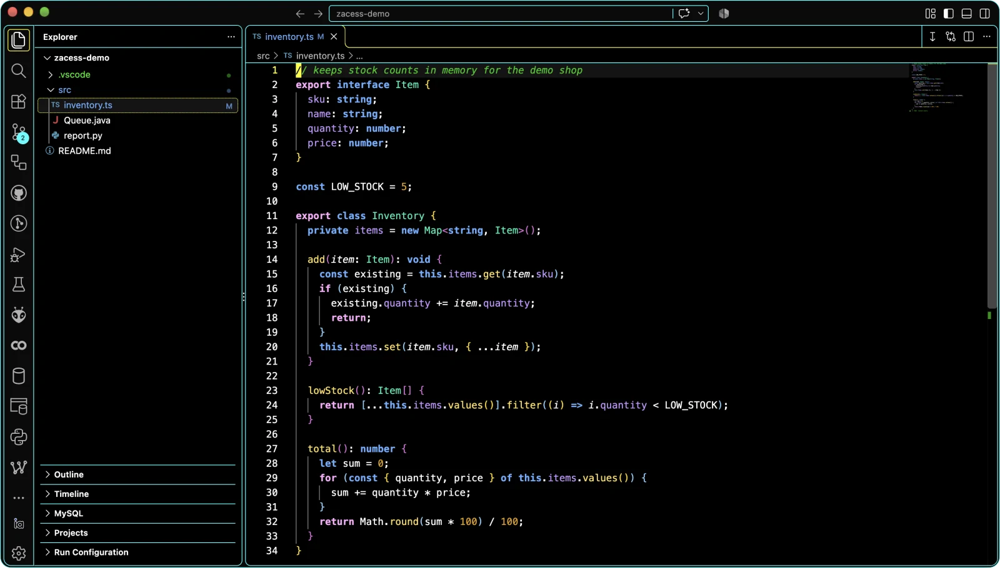
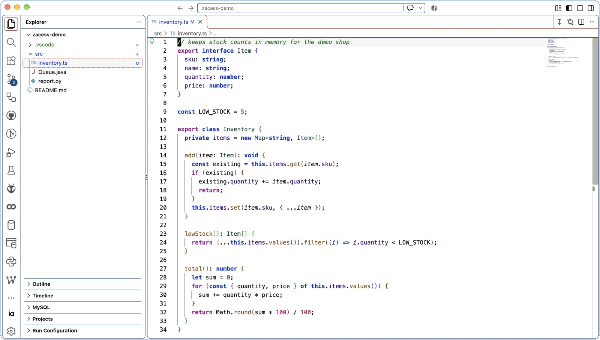
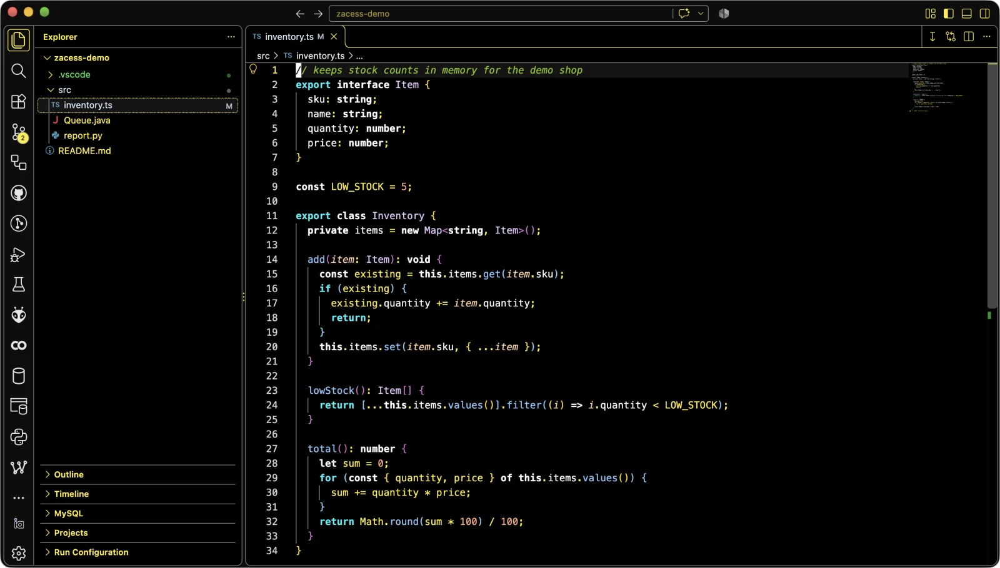
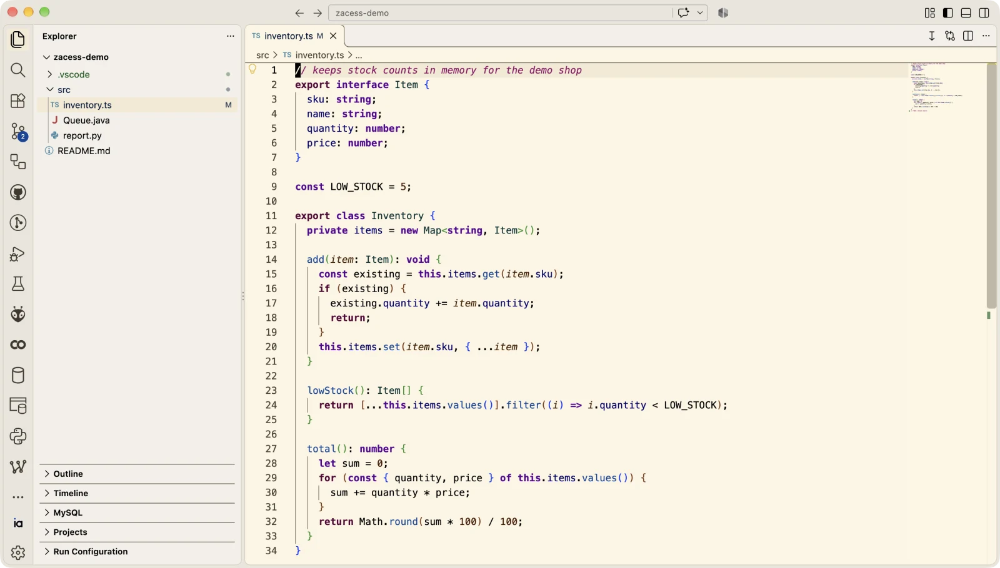
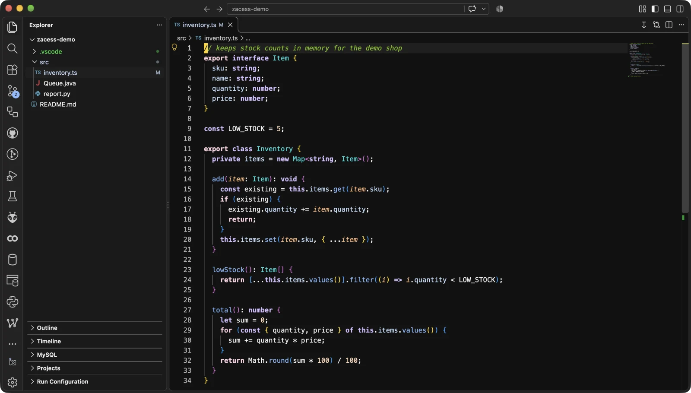
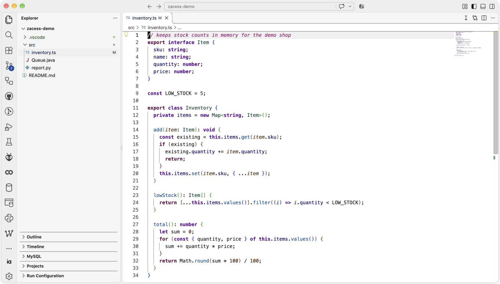
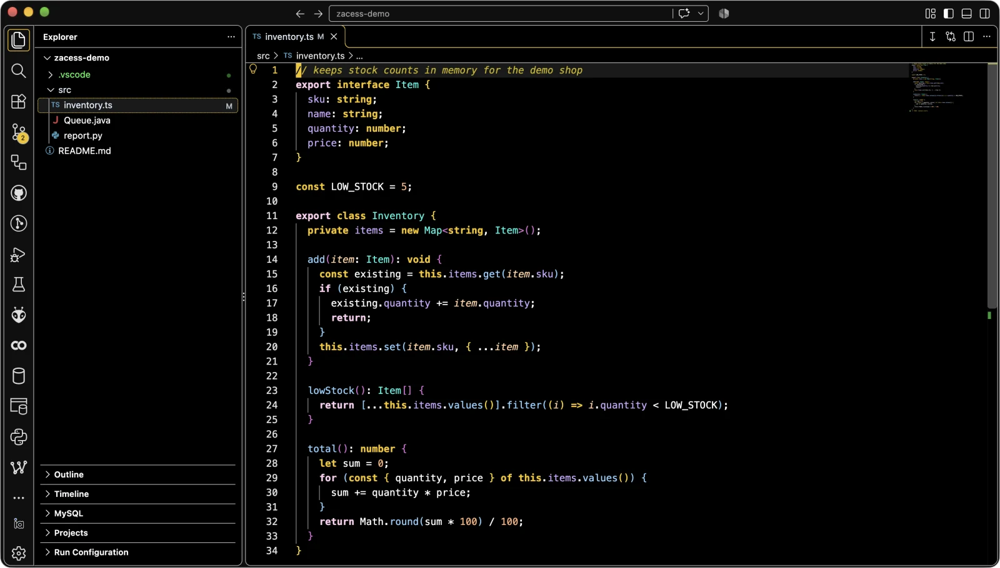
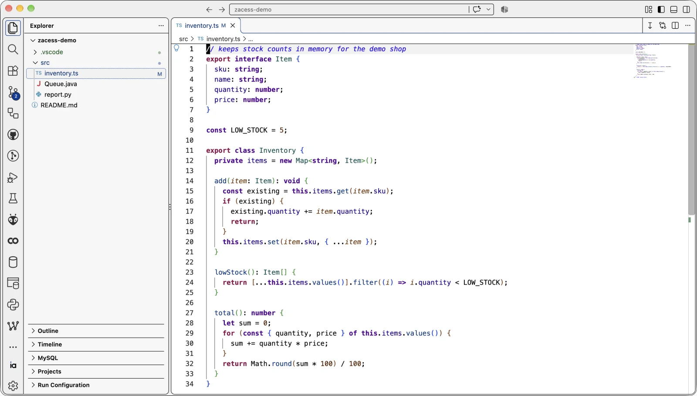

# vscode

> VS Code setup: settings, keybindings for macOS and Windows or Linux, global snippets, launch
> flags, project templates and a curated extension list.

## What's here

- [`settings.json`](settings.json) - user settings, identical on every platform.
- [`keybindings/`](keybindings/) - custom keybindings, one file for macOS (`cmd+alt`) and one for
  Windows and Linux (`ctrl+alt`).
- [`global.code-snippets`](global.code-snippets) - language-scoped snippets available in every
  project.
- [`argv.json`](argv.json) - launch-time flags.
- [`extensions.txt`](extensions.txt) - every extension, one `publisher.name@version` per line,
  grouped under `//` category headers. See [guides/extensions.md](guides/extensions.md).
- [`templates/`](templates/) - starting points for a project's own `launch.json` and `tasks.json`.

## In action

VS Code in each of the eight Zacess themes, with the same file open.

| Deep Contrast Dark | Deep Contrast Light |
| --- | --- |
|  |  |

| Yellow on Black | Cream |
| --- | --- |
|  |  |

| Dark | Light |
| --- | --- |
|  |  |

| High Contrast Dark | High Contrast Light |
| --- | --- |
|  |  |

The themes are from [Zacess Themes](https://github.com/zacesshq/themes).

## Setup

Full walkthrough in [guides/setup.md](guides/setup.md).

> [!WARNING]
> Pulling this folder does not update any live file by itself. The copy step has to run again for
> each file you want to refresh.

## Structure

| Path | Contents |
| --- | --- |
| [`ACCESSIBILITY.md`](ACCESSIBILITY.md) | The Zacess Deep Contrast theme, word wrap and the one-pattern shortcuts |
| [`keybindings/`](keybindings/) | Keybindings per platform family |
| [`templates/`](templates/) | Per-project debug and task templates |
| [`guides/`](guides/) | Setup, settings reference and extension detail |
| [`docs/demo/`](docs/demo/) | Screenshots of the editor in the Zacess themes |
