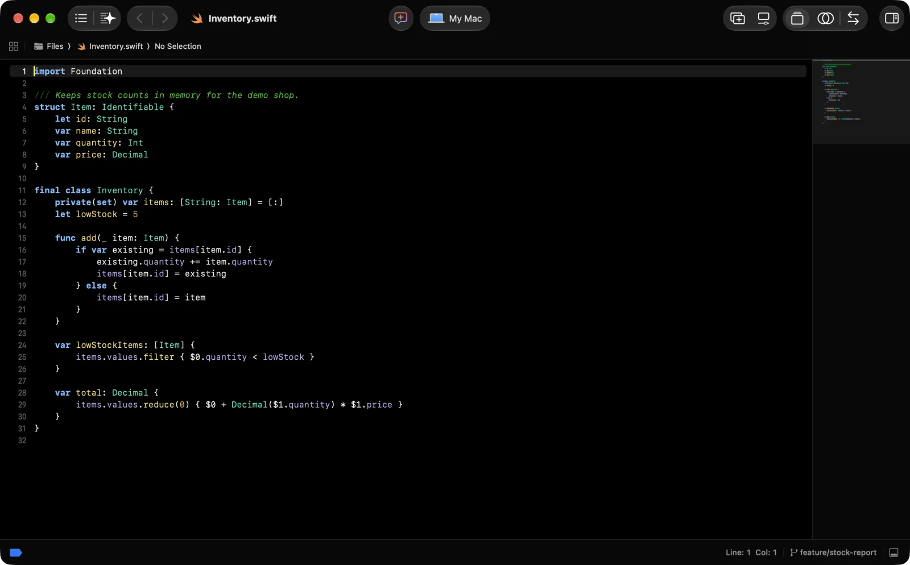

# xcode

> Xcode preferences for macOS: the eight Zacess colour themes, the recorded editor settings, the
> key bindings file and one script that installs them all.

Xcode keeps its preferences in the `com.apple.dt.Xcode` defaults domain, mixed in with a long list
of values it writes for itself (window sizes, recent files, first launch flags). Copying that whole
domain would carry all of that across, so this folder holds only the chosen settings and writes them
one key at a time.

## What's here

- [`prefs.txt`](prefs.txt) - the preferences, read from Xcode 27.1: the light and dark editor
  themes for Xcode 26 and earlier, the Xcode 27 theme setting, the key bindings set, predictive
  code completion off and automatic string catalog comments off.
- [`theme/`](theme/) - the eight Zacess Xcode themes from
  [Zacess Themes](https://github.com/zacesshq/themes) as `.xccolortheme` files, plus Zacess Deep
  Contrast Dark in Xcode 27's own `.xcworkspacecolortheme` format.
- [`KeyBindings/`](KeyBindings/) - the key bindings set Xcode keeps in
  `~/Library/Developer/Xcode/UserData/KeyBindings`. It holds no custom bindings yet.
- [`apply.sh`](apply.sh) - copies the themes and the key bindings file into Xcode's `UserData`
  folder, writes each recorded preference that differs and prints what changed. It backs up the
  defaults domain before the first write, refuses to run while Xcode is open and takes `--dry-run`
  to show what would change without writing anything.

## In action

Xcode in Zacess Deep Contrast Dark, the theme this setup restores, with a Swift file open.



The theme is from [Zacess Themes](https://github.com/zacesshq/themes), along with seven more.

## Setup

Full walkthrough in [guides/setup.md](guides/setup.md). In short, quit Xcode and run:

```bash
git clone https://github.com/zaccesss/dotfiles.git ~/dev/github/repos/dotfiles
~/dev/github/repos/dotfiles/editors/xcode/apply.sh
```

> [!IMPORTANT]
> Quit Xcode first. Xcode keeps its preferences in memory and writes them back while it runs, so a
> value set while it is open can be lost. The script checks and refuses.

> [!NOTE]
> Xcode 27 has a new theme system. **Import Classic Theme** under **Settings**, **Themes** turns a
> `.xccolortheme` into a `.xcworkspacecolortheme` file and records the choice in
> `DVTWorkspaceThemeSettings`. Both are included for Zacess Deep Contrast Dark, so no manual import
> is needed for it. The other seven themes import the same way in a few clicks.

## WakaTime

Xcode has no plugin system for WakaTime. Coding time in Xcode is tracked by the
[WakaTime app for macOS](https://wakatime.com/mac), which watches Xcode through the macOS
accessibility permission, so nothing for it lives in this folder.

## Structure

| Path | Contents |
| --- | --- |
| [`ACCESSIBILITY.md`](ACCESSIBILITY.md) | The themes, the editor font and the keyboard |
| [`prefs.txt`](prefs.txt) | Written to the `com.apple.dt.Xcode` defaults domain |
| [`theme/`](theme/) | Copied to `~/Library/Developer/Xcode/UserData/FontAndColorThemes/` |
| [`KeyBindings/`](KeyBindings/) | Copied to `~/Library/Developer/Xcode/UserData/KeyBindings/` |
| [`guides/`](guides/) | Setup walkthrough and the preferences reference |
| [`docs/demo/`](docs/demo/) | A screenshot of the editor in Zacess Deep Contrast Dark |
