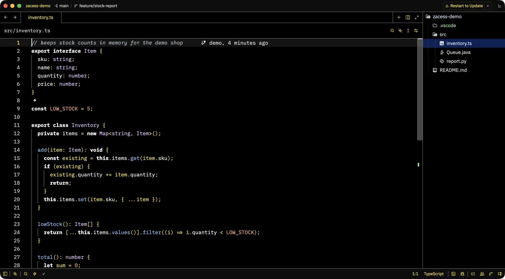

# zed

> Zed editor settings: the Zacess Deep Contrast Dark theme, the theme extensions it needs and setup
> guides for macOS, Linux and Windows.

## What's here

- [`settings.json`](settings.json) - interface and editor font sizes, the terminal font and the theme, fixed on
  `Zacess Deep Contrast Dark` with `Zacess Deep Contrast Light` as its light counterpart, plus
  `auto_install_extensions` so Zed installs both theme extensions on its own. Identical on every
  platform.
- [`extensions.txt`](extensions.txt) - the two theme extensions, one `id@version` per line.
- [`shared/themes/zacess.json`](shared/themes/zacess.json) - all eight Zacess themes in one Zed
  theme family, the file [Zacess Themes](https://github.com/zacesshq/themes) ships in
  `editors/zed/themes`, copied as released. [`shared/theme-package.json`](shared/theme-package.json)
  records the release it came from and the eight theme names.
- [`shared/apply.py`](shared/apply.py) with `mac/apply.sh`, `linux/apply.sh` and
  `windows/apply.ps1` - install the theme file and set the theme, see [Apply](#apply).

## In action

Zed in each of the eight Zacess themes, with the same file open.

| Deep Contrast Dark | Deep Contrast Light |
| --- | --- |
|  |  |

| Yellow on Black | Cream |
| --- | --- |
|  |  |

| Dark | Light |
| --- | --- |
|  |  |

| High Contrast Dark | High Contrast Light |
| --- | --- |
|  |  |

The themes are from [Zacess Themes](https://github.com/zacesshq/themes).

## Setup

Full walkthrough in [guides/setup.md](guides/setup.md): link or copy `settings.json` into Zed's
config folder (the Mac bootstrap's configs stage links it), then run the apply script. Each
bootstrap's apps stage runs the apply script too.

## Apply

```bash
mac/apply.sh                 # or linux/apply.sh
mac/apply.sh --theme cream   # another Zacess theme
```

```powershell
pwsh -File windows\apply.ps1
pwsh -File windows\apply.ps1 -Theme cream
```

The scripts print the theme file and the `theme` key as `added`, `changed`, `unchanged` or
`removed`. Running one again changes nothing. Zed reloads its settings and themes while it runs, so
unlike the other apply scripts these never check whether Zed is open and nothing needs restarting.
`mac/apply.sh` and `linux/apply.sh` are the same file; the work is done by
[`shared/apply.py`](shared/apply.py) with the system `python3`, which reuses `zt`'s own theme block
and JSON-with-comments editing from `shell/scripts/zt.py`, so `settings.json` keeps its comments and
layout and `zt` and the script write the same value. The `theme` block is set the way `zt` sets it:
`mode` fixed on the chosen theme's appearance, with the other half of the light and dark pair left
as it was.

| Platform | Themes folder | Config folder |
| --- | --- | --- |
| macOS | `~/.config/zed/themes` | `~/.config/zed` |
| Linux | `~/.config/zed/themes` (`$XDG_CONFIG_HOME/zed/themes` when set) | `~/.config/zed` or the `dev.zed.Zed` Flatpak's own copy |
| Windows | `%APPDATA%\Zed\themes` | `%APPDATA%\Zed` |

`--config-dir` (`-ConfigDir` on Windows) points the script anywhere else. With no `settings.json`
in the folder yet the script installs the theme file and says the settings are not there yet.

## While the extension store catches up

`settings.json` lists `zacess-themes` under `auto_install_extensions`, so Zed installs the Zacess
Themes extension on its own. The store still has 0.2.1, which lacks `Zacess Deep Contrast Dark` and
`Zacess Deep Contrast Light`; the theme file in `shared/themes` is the 0.4.0 release, which has
them, so Zed shows every theme now. The script reads the installed extension's version from Zed's
data folder. Once it reaches the version in `theme-package.json`, the script removes the local file
instead, so the themes never load twice.

## Check it worked

1. Open the theme picker with `Cmd+K` then `Cmd+T` (`Ctrl+K` then `Ctrl+T` on Windows and Linux):
   all eight Zacess theme names are listed.
2. Zed shows black backgrounds with white text in `Zacess Deep Contrast Dark`, with keywords bold
   blue, strings orange and comments green.
3. `zt current` reports Zed as `fixed: Zacess Deep Contrast Dark`.

## Validation

[`scripts/validate.py`](scripts/validate.py) runs in CI on Linux. It checks the theme file parses
and defines exactly the eight themes `theme-package.json` names, that the package points at the
pinned release's file, that `settings.json` names themes from the file, that `shared/apply.py`
parses and that the two shell scripts match.

## Structure

| Path | Contents |
| --- | --- |
| [`ACCESSIBILITY.md`](ACCESSIBILITY.md) | Measured contrast for the Deep Contrast themes and the font sizes |
| [`settings.json`](settings.json) | Installs to `~/.config/zed/` on macOS and Linux, `%APPDATA%\Zed\` on Windows |
| [`shared/`](shared/) | The theme file, the release it came from and the apply script's Python |
| [`mac/`](mac/), [`linux/`](linux/) and [`windows/`](windows/) | The apply script for each platform |
| [`scripts/`](scripts/) | The validator CI runs |
| [`guides/`](guides/) | Setup walkthrough and settings reference |
| [`docs/demo/`](docs/demo/) | Screenshots of the editor in the Zacess themes |
