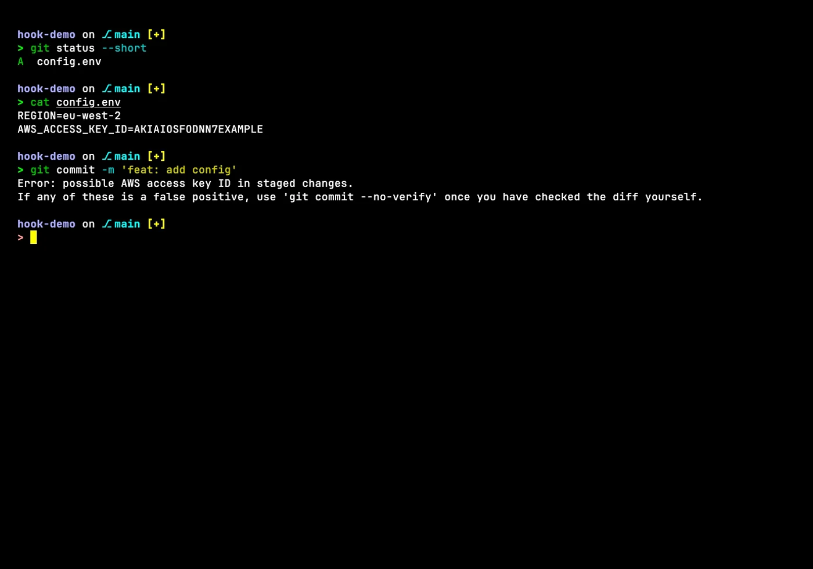
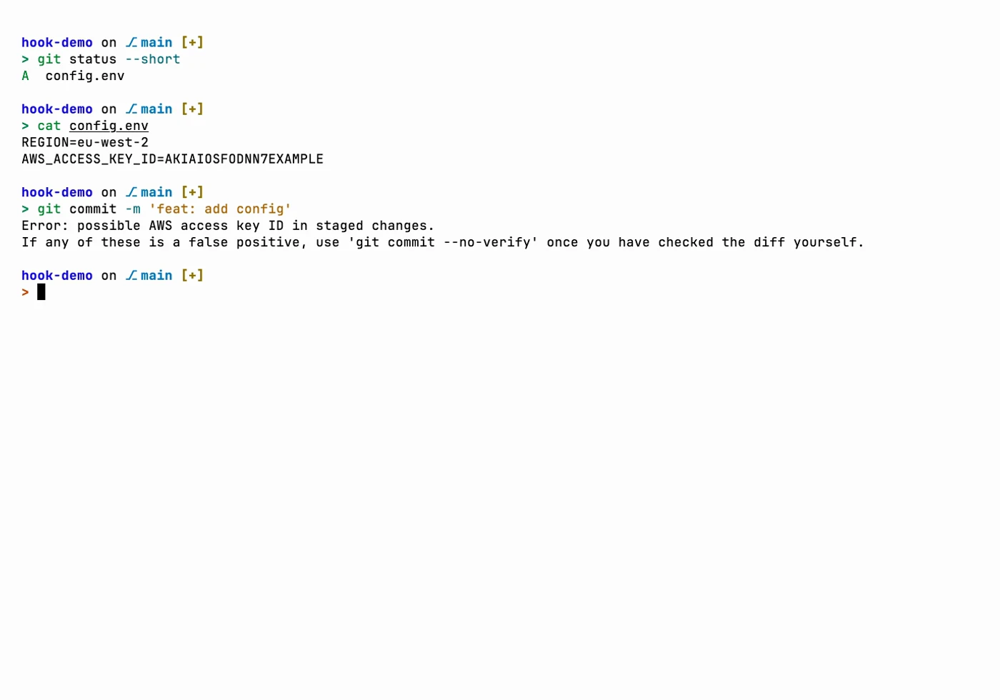
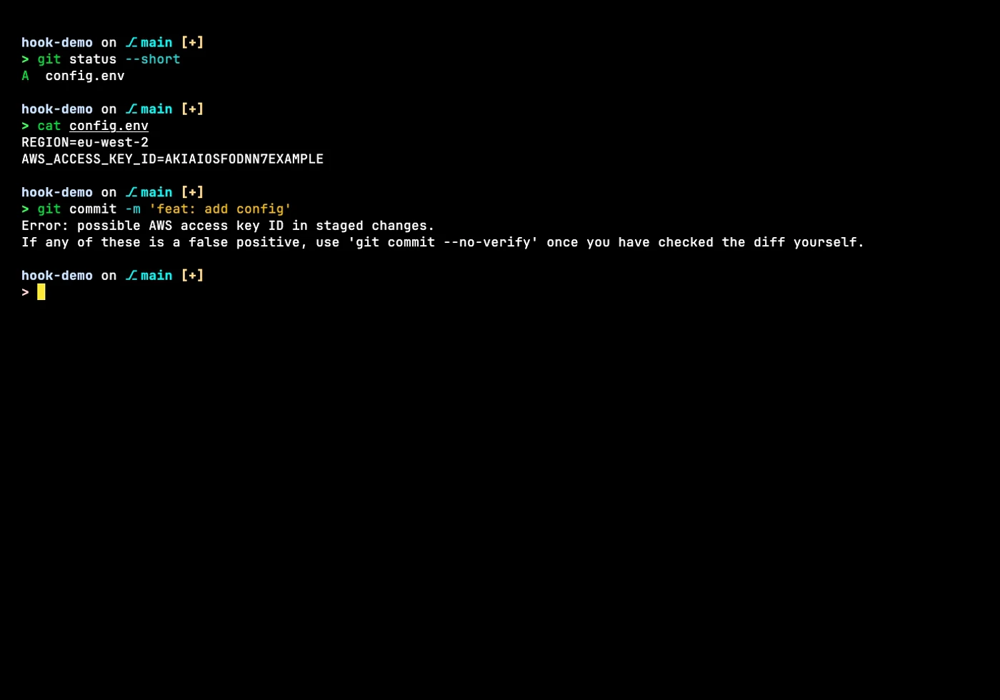
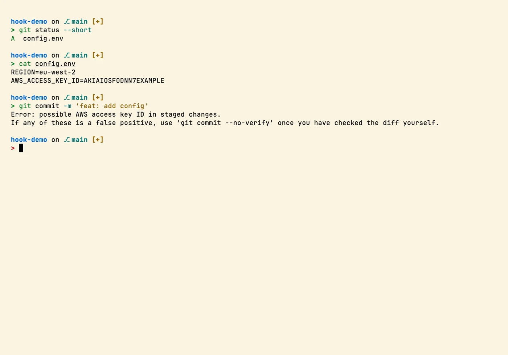

# git-hooks

> A small git hooks framework: secret scanning, a large file and force push guard and a
> commit subject length check, with a documented extension point for your own rules.

A commit or push should never carry a leaked key, a huge binary blob or a rewritten history on
main by accident. These hooks catch that before it happens, keep commit messages within a
sensible shape and leave a clear place to add whatever else matters to you.

Set `core.hooksPath` globally and these run regardless of what makes the commit: a terminal
`git commit` or an IDE. A single, unavoidable policy that lives outside any one tool's own
settings, not something each tool has to opt into separately.

## In action

Screenshots in four Zacess themes, Deep Contrast Dark and Light, Yellow on Black and Cream,
recorded in a demo project. Each one links to a short animation of the same scene.

### A blocked commit

| Deep Contrast Dark | Deep Contrast Light |
| --- | --- |
| [](docs/demo/git-hooks-dark.gif) | [](docs/demo/git-hooks-light.gif) |

| Yellow on Black | Cream |
| --- | --- |
| [](docs/demo/git-hooks-yellow-on-black.gif) | [](docs/demo/git-hooks-cream.gif) |

The shots show the real config in a throwaway demo project, in
[Zacess Themes](https://github.com/zacesshq/themes) Deep Contrast Dark and Light, Yellow on Black
and Cream.

## What's here

- **`commit-msg`** - blocks a subject line over 72 characters.
- **`pre-commit`** - blocks a commit containing a known secret pattern (cloud provider keys,
  source control tokens, payment and messaging API keys, private key headers,
  database connection strings with an embedded password), a file at or over 50MB not
  tracked by Git LFS or an `.env`-pattern file. Warns, does not block, on committing directly
  to `main`/`master`.
- **`pre-push`** - blocks a force-push that would rewrite `main`/`master`'s history. Passes
  through to Git LFS's own pre-push hook afterward, for any repo that uses LFS.
- **`post-checkout`, `post-commit`, `post-merge`** - plain Git LFS passthrough, unrelated to
  policy.

See [guides/checks.md](guides/checks.md) for the full list of what each hook matches, with
examples, plus [guides/extending.md](guides/extending.md) for how to add your own checks.

> [!NOTE]
> Every block has an escape hatch: `git commit --no-verify` or `git push --no-verify` skips
> these hooks entirely for that one operation. Use it deliberately, not as a habit.

macOS ships BSD `sed`, Linux ships GNU `sed` and Git for Windows runs hooks through its
bundled MSYS2 shell, which behaves like GNU `sed`. That's the only real per-OS difference in
this folder (one `-i` flag and one `stat` flag), which is why `mac/`, `linux/` and `windows/`
each carry their own copy rather than one script branching on `$OSTYPE` at runtime.

## Setup

> [!WARNING]
> Git LFS must be installed first (`brew install git-lfs`, `sudo apt install git-lfs` or
> `winget install GitHub.GitLFS`, then `git lfs install --skip-repo`). Four of the hooks hand over
> to `git lfs` and fail without it. See [guides/setup.md](guides/setup.md#requirements).

Each platform folder is fully self-contained, one copy step and you're done:

```bash
git clone https://github.com/zaccesss/dotfiles.git ~/dev/github/repos/dotfiles
mkdir -p ~/.git-hooks
cp ~/dev/github/repos/dotfiles/git/git-hooks/<platform>/commit-msg \
   ~/dev/github/repos/dotfiles/git/git-hooks/<platform>/post-checkout \
   ~/dev/github/repos/dotfiles/git/git-hooks/<platform>/post-commit \
   ~/dev/github/repos/dotfiles/git/git-hooks/<platform>/post-merge \
   ~/dev/github/repos/dotfiles/git/git-hooks/<platform>/pre-commit \
   ~/dev/github/repos/dotfiles/git/git-hooks/<platform>/pre-push \
   ~/.git-hooks/
chmod +x ~/.git-hooks/*
git config --global core.hooksPath ~/.git-hooks
```

Replace `<platform>` with `mac`, `linux` or `windows`. See [guides/setup.md](guides/setup.md)
for the full walkthrough.

## Onboarding a new device

> [!TIP]
> Don't assume the setup commands above ran cleanly. Run `git config --get core.hooksPath` and
> confirm it points at the right directory, then `ls` that directory to confirm every file
> actually copied rather than half-completing. Check which `sed`/`stat` the machine ships
> (`sed --version` prints "GNU sed" on Linux and Windows' Git Bash, prints nothing recognisable
> on macOS's BSD sed) before assuming the platform folder you copied is the right one.

## Adding your own checks

> [!TIP]
> Each hook has a marked extension point where you add whatever reflects your own conventions:
> a content-style rule, a naming convention, a required commit type prefix or a licence-header
> check. See [guides/extending.md](guides/extending.md).

## Structure

| Path | Contents |
| --- | --- |
| [`mac/`](mac/) | All 6 hooks, using BSD `sed`/`stat` |
| [`linux/`](linux/) | All 6 hooks, using GNU `sed`/`stat` |
| [`windows/`](windows/) | All 6 hooks, identical to `linux/`, since Git for Windows runs hooks through its bundled MSYS2 shell |
| [`guides/`](guides/) | Full install walkthrough, the complete check reference and the extending guide |
