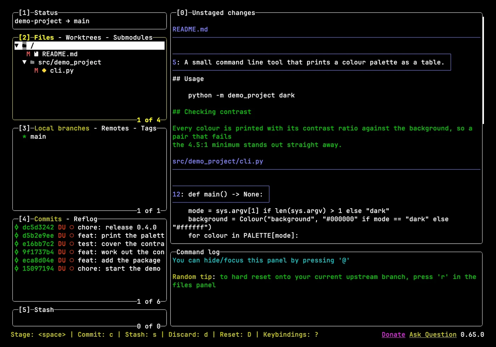
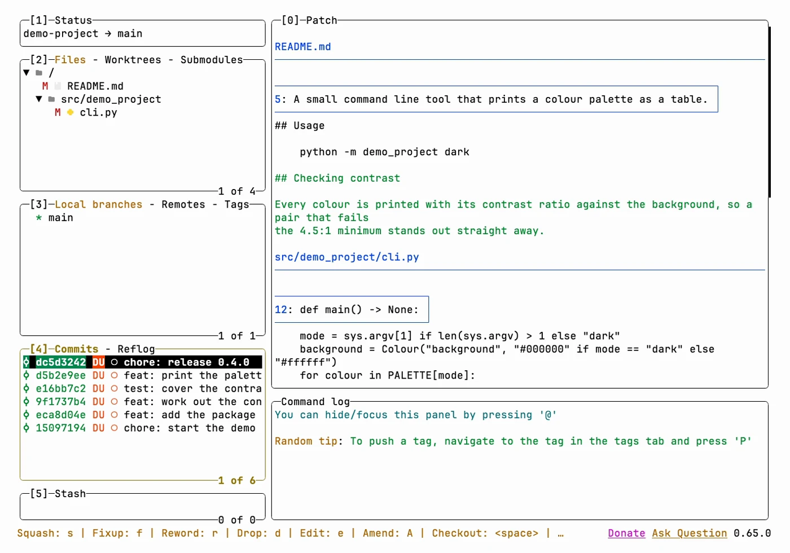
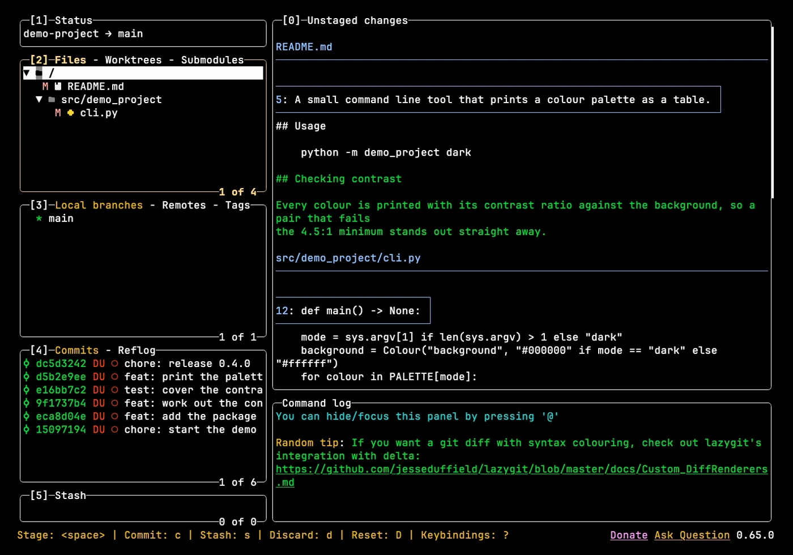
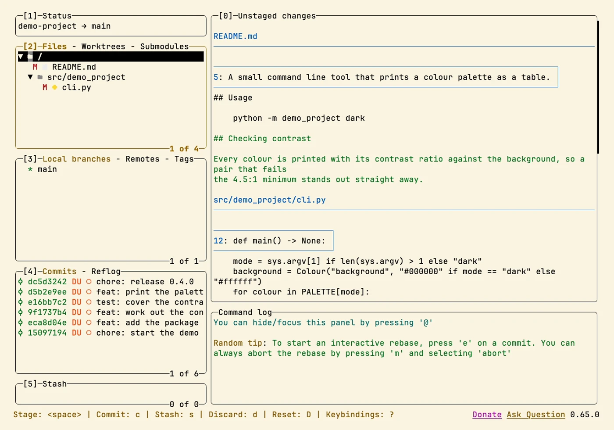
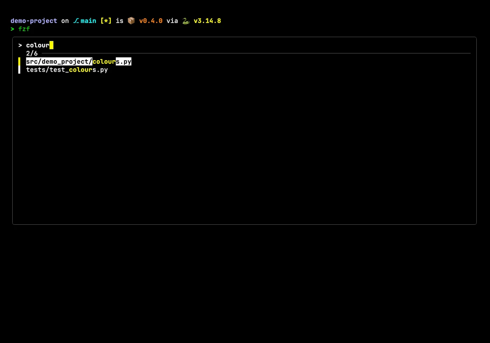
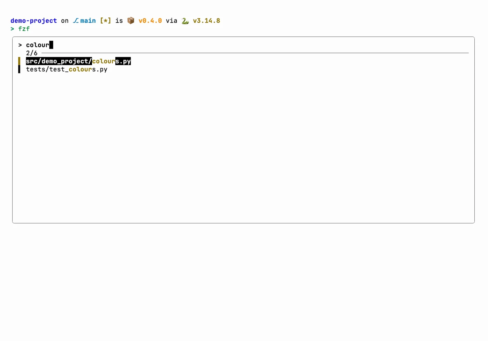
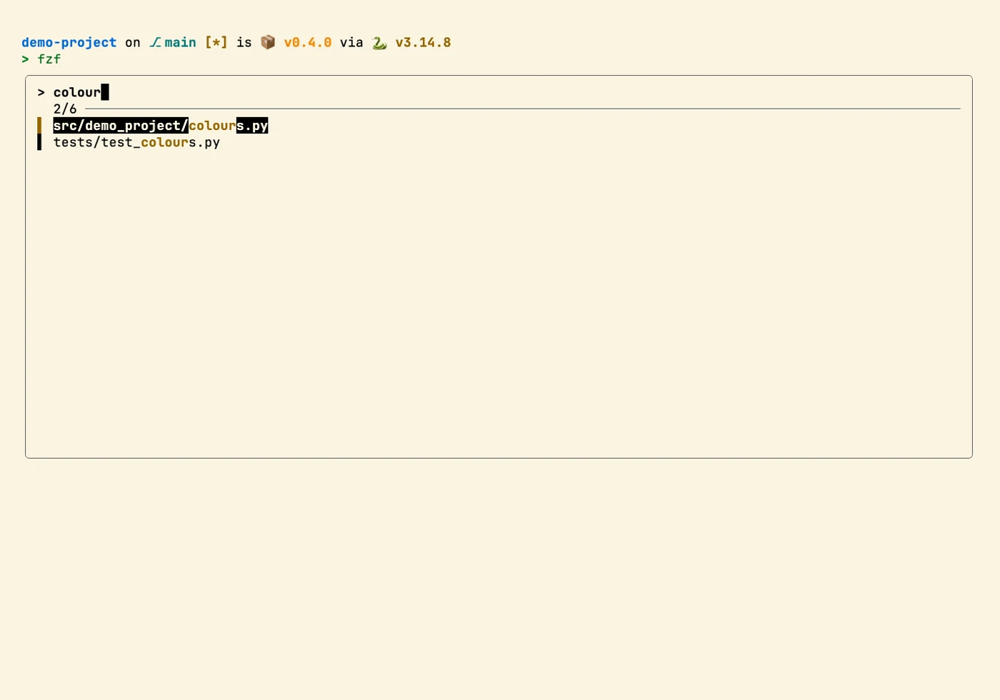

# cli-tools

> Config for ripgrep, fzf, lazygit and zoxide: sensible defaults, a high-contrast theme and
> vi-style navigation, with per-platform install paths.

## In action

Screenshots in four Zacess themes, Deep Contrast Dark and Light, Yellow on Black and Cream,
recorded in a demo project. Each one links to a short animation of the same scene.

### lazygit

| Deep Contrast Dark | Deep Contrast Light |
| --- | --- |
|  |  |

| Yellow on Black | Cream |
| --- | --- |
|  |  |

### fzf

| Deep Contrast Dark | Deep Contrast Light |
| --- | --- |
|  |  |

| Yellow on Black | Cream |
| --- | --- |
|  |  |

The shots show the real config in a throwaway demo project, in
[Zacess Themes](https://github.com/zacesshq/themes) Deep Contrast Dark and Light, Yellow on Black
and Cream.

## What's here

Each top-level folder is one tool, holding its config file and a README on where that config
belongs, since install paths differ more than for a typical dotfile. lazygit's config path alone
differs on all three platforms.

| Folder | Tool | Config location |
| --- | --- | --- |
| [`ripgrep/`](ripgrep/) | ripgrep | Anywhere, pointed at with `RIPGREP_CONFIG_PATH` |
| [`fzf/`](fzf/) | fzf | `~/.config/fzf/fzf.zsh`, sourced from your shell rc |
| [`lazygit/`](lazygit/) | lazygit | Differs by OS, see [`lazygit/README.md`](lazygit/README.md) |
| [`zoxide/`](zoxide/) | zoxide | No config file, only a shell hook |

## Setup

Full walkthrough in [guides/setup.md](guides/setup.md). Each tool's own README has its exact
install path and commands.

> [!IMPORTANT]
> ripgrep only reads its config through the `RIPGREP_CONFIG_PATH` environment variable. Copying
> `ripgreprc` into place does nothing on its own, see [`ripgrep/README.md`](ripgrep/README.md).

## Structure

| Path | Contents |
| --- | --- |
| [`ACCESSIBILITY.md`](ACCESSIBILITY.md) | High-contrast fzf colours and how the tools cut typing and memory load |
| `<tool>/` | That tool's config file and a README on its install path |
| [`guides/`](guides/) | Setup walkthrough and reference |
