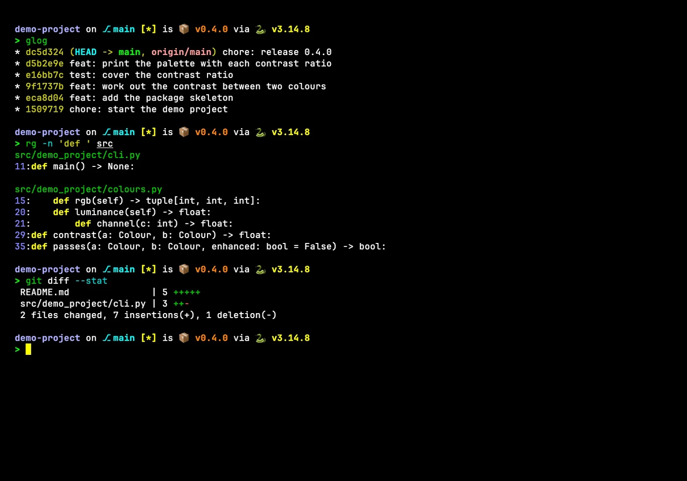
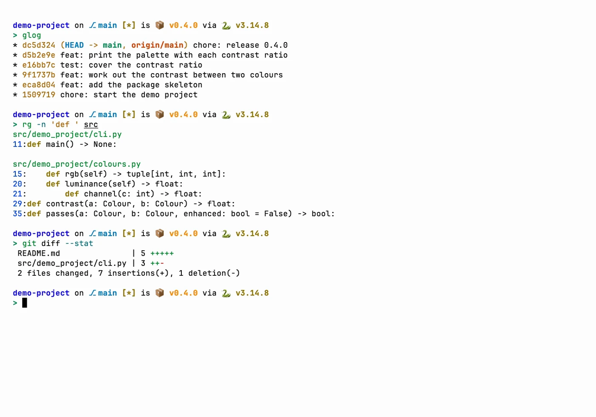
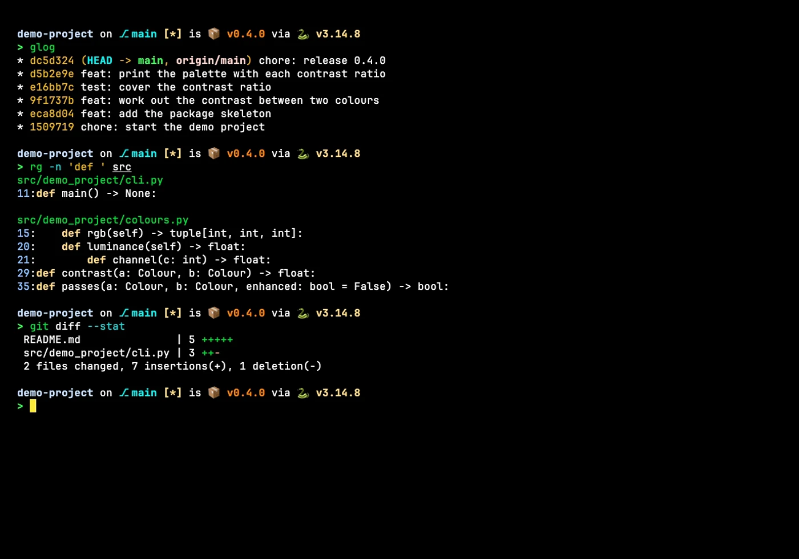
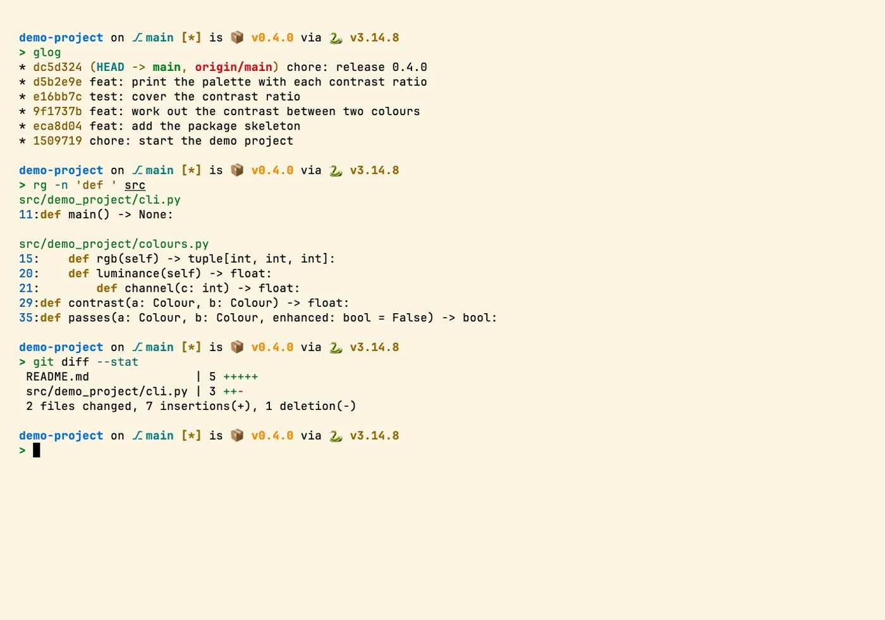
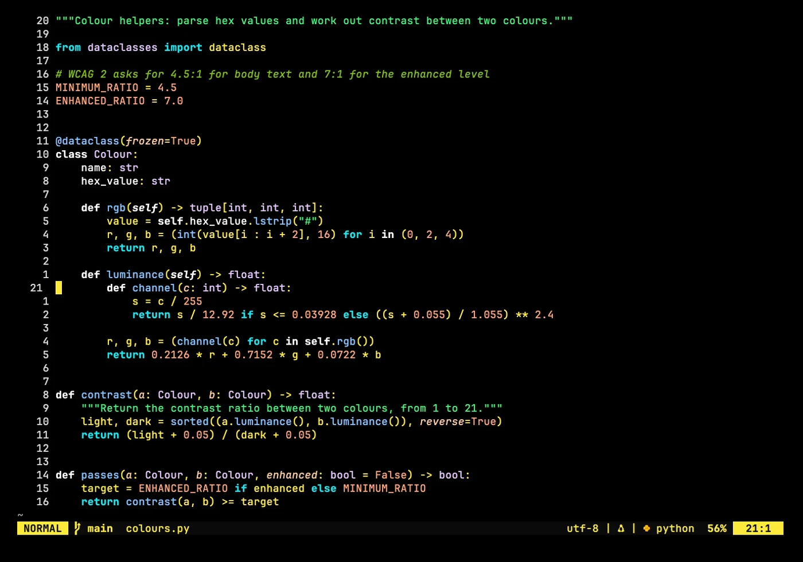
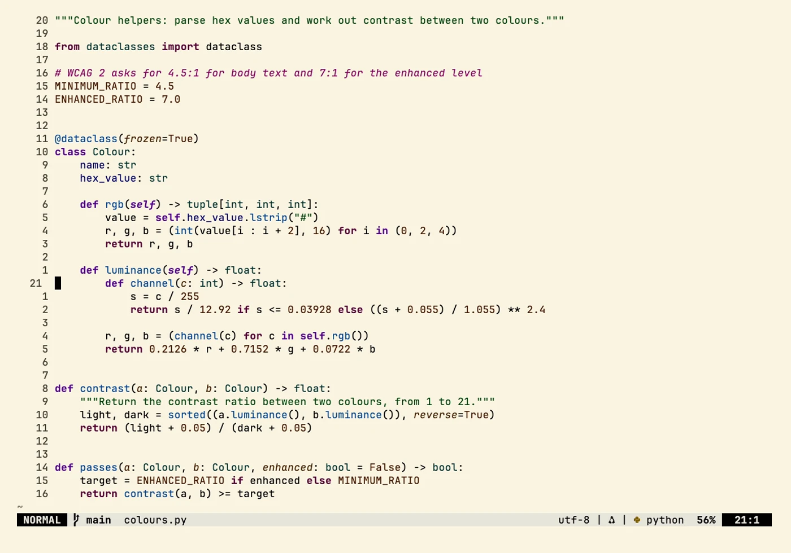
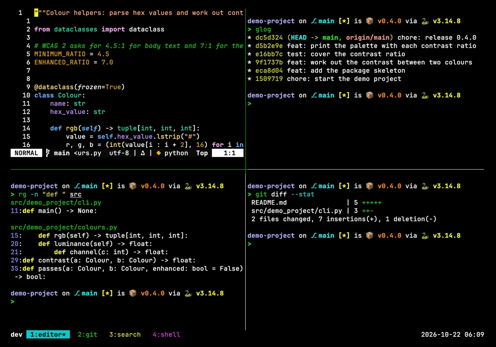
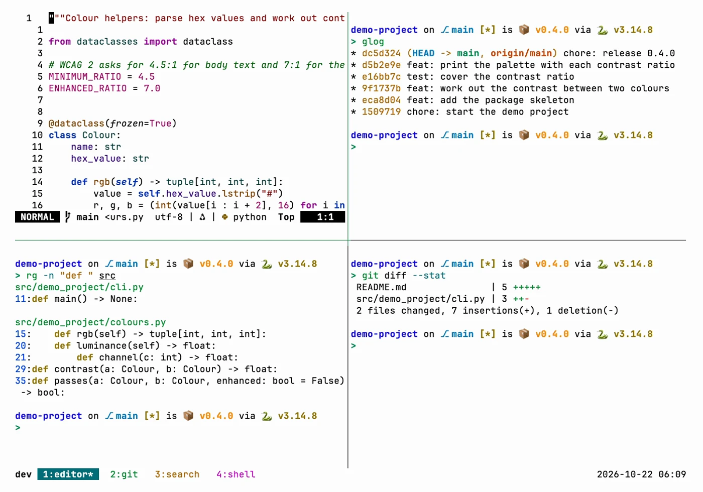
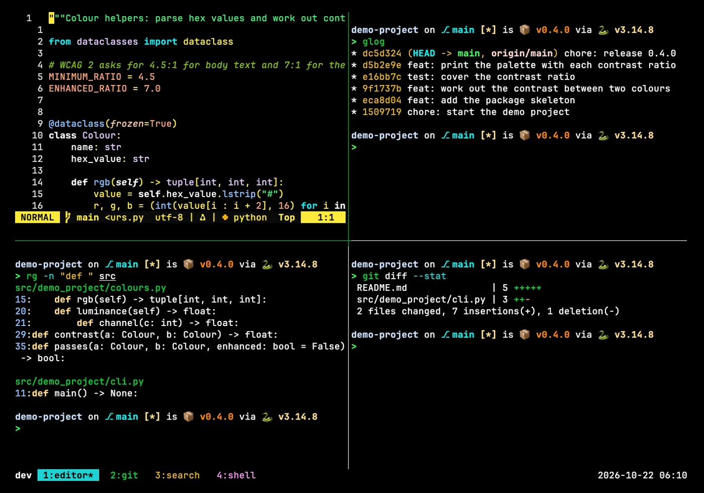
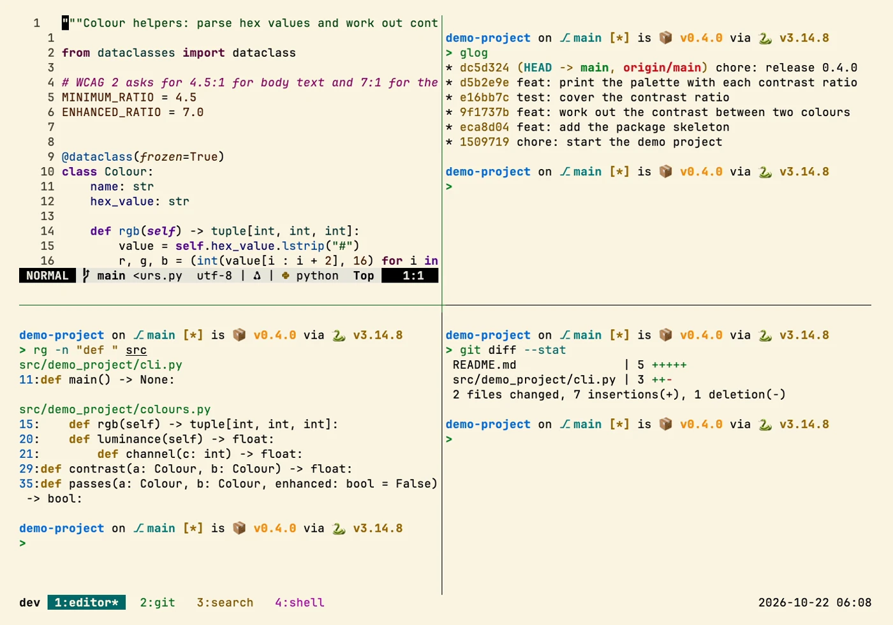

# terminal

> The eight Zacess colour themes for Terminal.app, iTerm2, Windows Terminal, Ptyxis, GNOME
> Terminal, Alacritty, Kitty and Hyper, with Zacess Deep Contrast Dark as the default, plus starter
> configs with per-platform fonts.

## In action

Screenshots in four Zacess themes, Deep Contrast Dark and Light, Yellow on Black and Cream,
recorded in a demo project. Each one links to a short animation of the same scene.

### Shell

| Deep Contrast Dark | Deep Contrast Light |
| --- | --- |
|  |  |

| Yellow on Black | Cream |
| --- | --- |
|  |  |

### Neovim

| Deep Contrast Dark | Deep Contrast Light |
| --- | --- |
|  |  |

| Yellow on Black | Cream |
| --- | --- |
|  |  |

### tmux

| Deep Contrast Dark | Deep Contrast Light |
| --- | --- |
|  |  |

| Yellow on Black | Cream |
| --- | --- |
|  |  |

The shots show the real config in a throwaway demo project, in
[Zacess Themes](https://github.com/zacesshq/themes) Deep Contrast Dark and Light, Yellow on Black
and Cream.

## What's here

Every terminal gets all eight Zacess themes from [Zacess Themes](https://github.com/zacesshq/themes),
with Zacess Deep Contrast Dark as the default: white on pure black with deep, fully saturated
colours. The theme stays fixed whatever the system appearance until it is changed. The colours live
in one file, [`palette/zacess.json`](palette/zacess.json).
[`scripts/sync-palette.py`](scripts/sync-palette.py) copies it from a pinned Zacess Themes release and
[`scripts/build-themes.py`](scripts/build-themes.py) writes every theme file and the tmux theme files from it. Every theme's
colours and how each terminal switches are in [guides/themes.md](guides/themes.md).

| Terminal | macOS | Linux | Windows |
| --- | --- | --- | --- |
| Alacritty | [`mac/alacritty/`](mac/alacritty/) | [`linux/alacritty/`](linux/alacritty/) | [`windows/alacritty/`](windows/alacritty/) |
| Kitty | [`mac/kitty/`](mac/kitty/) | [`linux/kitty/`](linux/kitty/) | not available, Kitty has no Windows build |
| Hyper | [`mac/hyper/`](mac/hyper/) | [`linux/hyper/`](linux/hyper/) | [`windows/hyper/`](windows/hyper/) |
| Terminal.app | [`mac/terminal-app/`](mac/terminal-app/) | not available | not available |
| iTerm2 | [`mac/iterm2/`](mac/iterm2/) | not available | not available |
| Ptyxis and GNOME Terminal | not available | [`linux/ptyxis/`](linux/ptyxis/), [`linux/gnome-terminal/`](linux/gnome-terminal/) | not available |
| Windows Terminal | not available | not available | [`windows/windows-terminal/`](windows/windows-terminal/) |

## Setup

Full walkthrough in [guides/setup.md](guides/setup.md), with the install path for each terminal
on each platform. Palette and font choices are explained in [guides/reference.md](guides/reference.md).

## Structure

| Path | Contents |
| --- | --- |
| [`ACCESSIBILITY.md`](ACCESSIBILITY.md) | Light and dark contrast, opaque windows and font sizing |
| [`palette/`](palette/) | The eight Zacess themes' terminal colours, the single source for every colour |
| [`scripts/`](scripts/) | `build-themes.py` writes every theme file from the palette and `sync-palette.py` copies the palette from a pinned Zacess Themes release |
| `<platform>/<terminal>/` | That terminal's config file for that platform |
| [`guides/`](guides/) | Setup walkthrough and reference |
