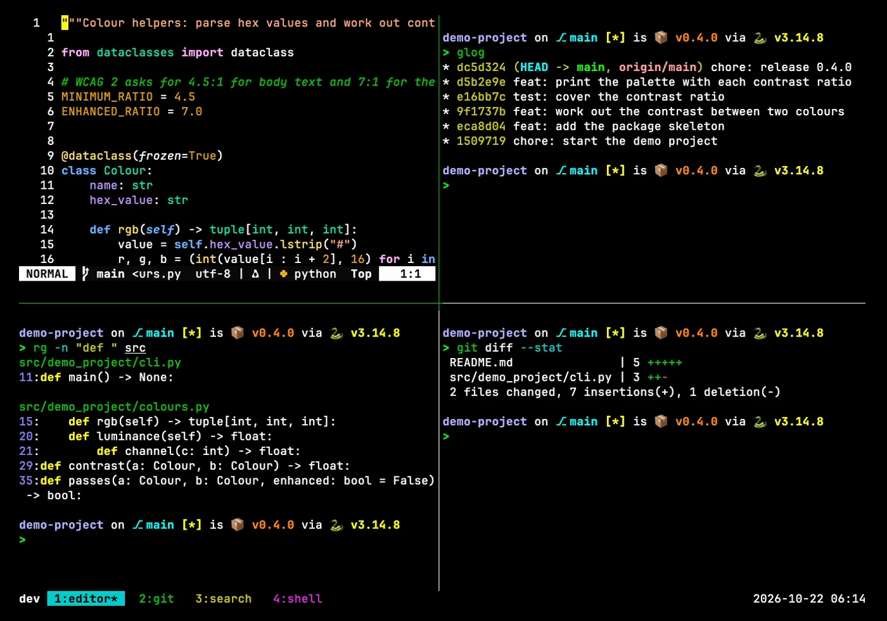
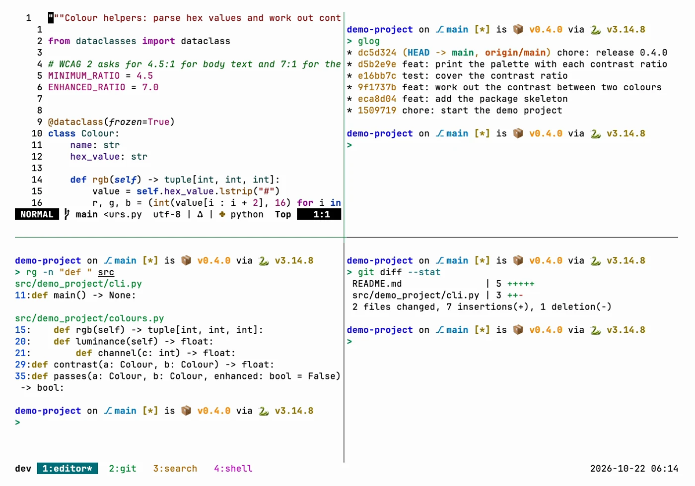
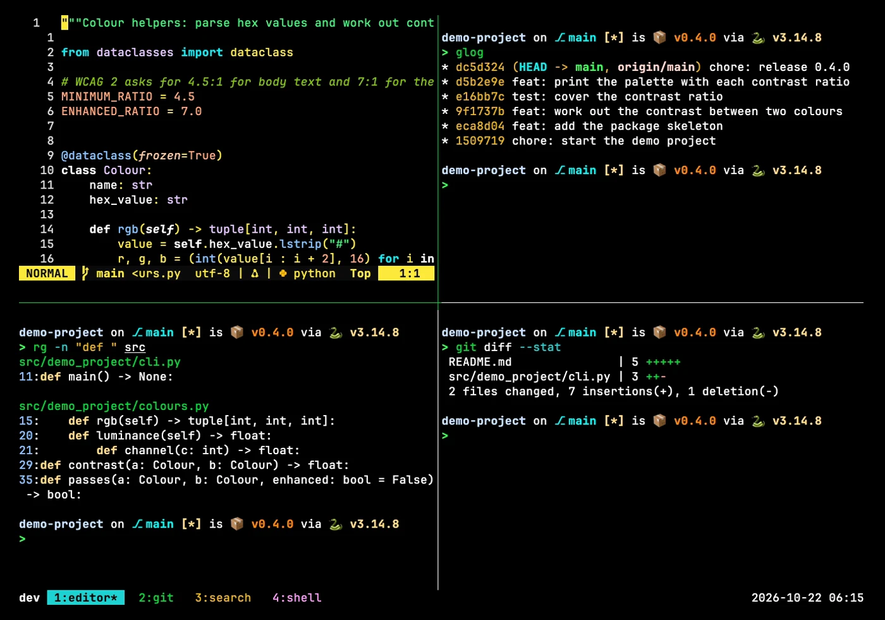
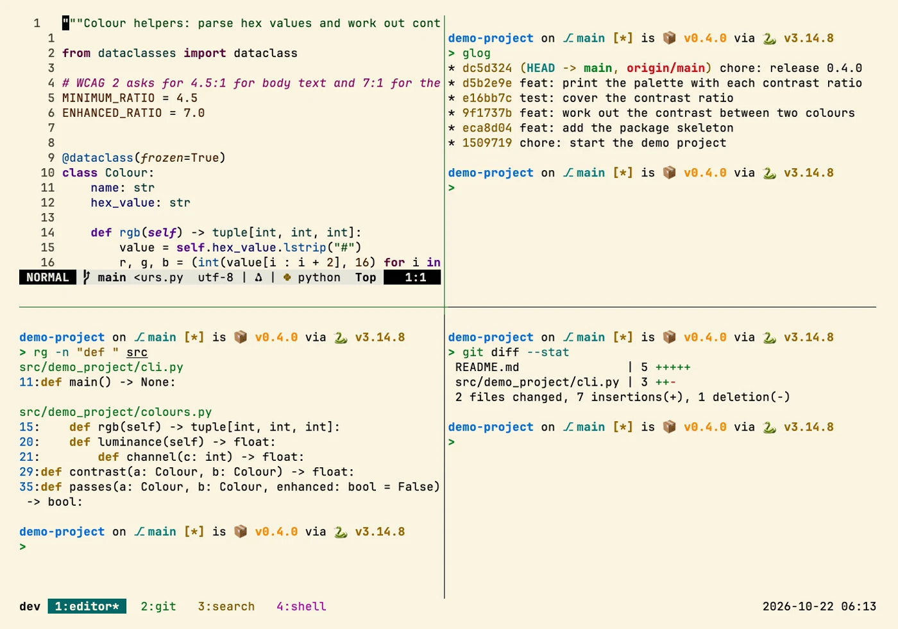

# tmux

> tmux config with vi-style copy mode and pane navigation, a plain high-contrast status bar and
> TPM plugins for session persistence across restarts.

## In action

Screenshots in four Zacess themes, Deep Contrast Dark and Light, Yellow on Black and Cream,
recorded in a demo project. Each one links to a short animation of the same scene.

### tmux

| Deep Contrast Dark | Deep Contrast Light |
| --- | --- |
|  |  |

| Yellow on Black | Cream |
| --- | --- |
|  |  |

The shots show the real config in a throwaway demo project, in
[Zacess Themes](https://github.com/zacesshq/themes) Deep Contrast Dark and Light, Yellow on Black
and Cream.

## What's here

- **[`tmux.conf`](tmux.conf)** - the full config: tmux's default `Ctrl-b` prefix, vi-style copy
  mode and pane navigation, a status bar in the terminal's own colours and TPM-managed plugins that save and restore
  sessions across a restart.

## Setup

Full walkthrough in [guides/setup.md](guides/setup.md): install tmux and TPM, copy the config,
install the plugins, start a session.

> [!IMPORTANT]
> tmux has no native Windows build, since it depends on POSIX pty support Windows does not have.
> On Windows the config only works inside WSL.

## Structure

| Path | Contents |
| --- | --- |
| [`ACCESSIBILITY.md`](ACCESSIBILITY.md) | The high-contrast status bar and short, consistent bindings |
| [`tmux.conf`](tmux.conf) | Installs to `~/.tmux.conf` on macOS, Linux and inside WSL |
| [`guides/`](guides/) | Setup walkthrough and full reference |
